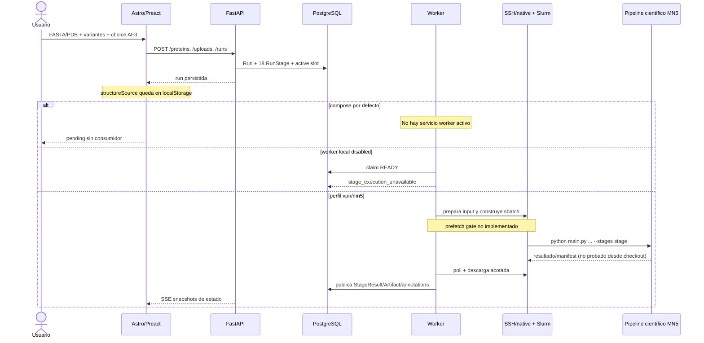
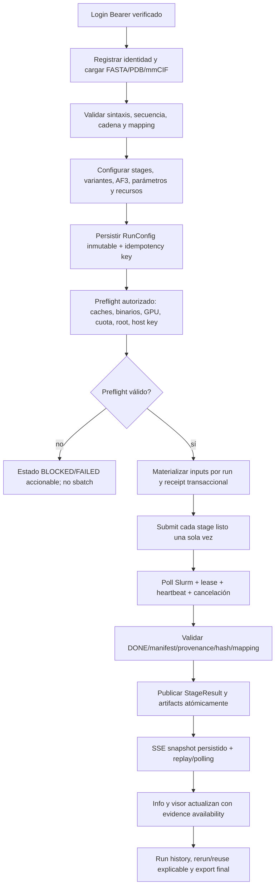
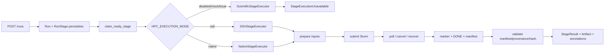
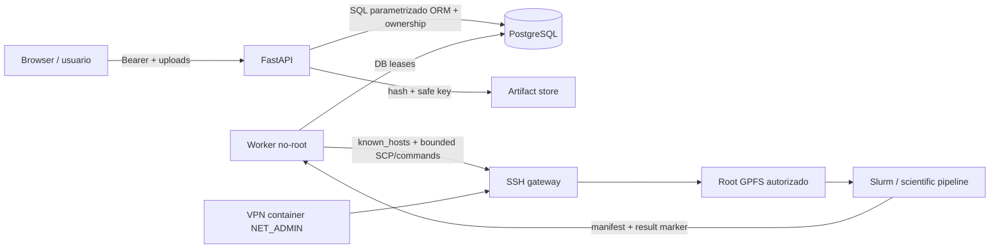
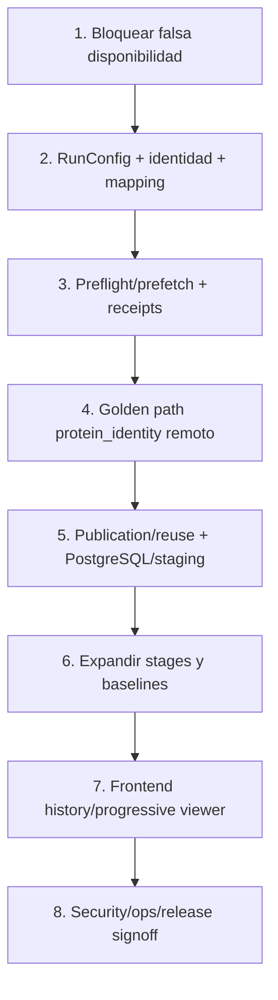

# Auditoría integral del producto — Residue Annotation Platform

**Fecha de corte:** 2026-10-14

**Checkout auditado:** `develop`, con cambios de trabajo preexistentes conservados

**Alcance:** inspección estática exhaustiva del repositorio, ejecución de pruebas locales seguras y lectura de contratos/documentación ya presentes. No se leyeron `.env`, `run/secrets/` ni ningún secreto; no se ejecutaron VPN, SSH, SFTP, `sbatch`, `salloc`, `scancel`, jobs científicos ni escrituras en MN5/GPFS.

**Artefacto único generado:** este archivo. No se modificaron código, specs, esquemas, configuración ni datos de producto. Las rutas citadas son relativas a la raíz del repo; en las secciones de backend, un nombre corto como `runs/service.py` se refiere a `backend/app/features/runs/service.py`.

## 1. Executive Summary

### Veredicto ejecutivo

**Estado global: NO-GO para release científico/productivo.** El repositorio entrega un plano local sólido para identidad, autenticación, uploads acotados, persistencia de runs, DAG, API REST/SSE, leases/reintentos, ownership, almacenamiento verificado y un visor Mol* conectado a datos publicados. Sin embargo, el camino de negocio que el usuario necesita —configurar una corrida, ejecutar los 18 stages científicos reales, publicar resultados parciales y finales, y volver a consultarlos históricamente— no está demostrado y tiene varios bloqueos concretos.

La conclusión no es que todo sea mock. Al contrario: el backend falla de forma deliberada cuando no existe un adapter científico revisado, y eso evita fabricar resultados. El problema de producto es que la experiencia puede crear una run que queda pendiente, falla al alcanzar el worker o no representa fielmente el DAG debido a políticas de presentación hardcodeadas. La integración SSH/native contiene fronteras y adaptadores razonables, pero la ruta real hasta Slurm, el preflight de cachés y la publicación desde un worker conectado no se ejecutaron en este checkout.

### Evidencia ejecutable reproducida

Estas comprobaciones fueron ejecutadas durante la auditoría, sin VPN, sin secretos y sin modificar fuentes:

| Comprobación | Resultado | Qué demuestra | Qué no demuestra |
| --- | --- | --- | --- |
| `uv run --offline pytest -q -p no:cacheprovider --disable-warnings` en `backend/` | **209 passed, 11 skipped** | Contratos y lógica local cubiertos por la suite disponible | Las 11 pruebas de concurrencia PostgreSQL no corrieron: falta `POSTGRES_TEST_DATABASE_URL`; tampoco demuestra MN5 |
| `pnpm test` en `frontend/` | **12 passed, 0 failed** | Colores, estados de presentación, elección local de estructura y utilidades | No demuestra navegación de navegador, SSE real, Mol* en un browser ni publicación de artefactos |
| `pnpm check` | **0 errores, 0 warnings, 0 hints** | Diagnóstico Astro/TypeScript limpio en el checkout actual | No es una prueba E2E |
| `uv run --offline ruff check app alembic tests` | **PASS** | Lint backend | No evalúa contratos remotos |
| `uv run --offline ruff format --check app alembic tests` | **83 files already formatted** | Formato backend | No evalúa ciencia |
| `python scripts/validate_specs.py` | **PASS** | Árbol de specs, puertos, registry de 18 IDs y ausencia de fixtures prohibidos | La spec no es evidencia de ejecución |
| `python scripts/secret_scan.py` | **PASS** | No detectó material de credenciales en archivos versionados y scripts auditados | No prueba rotación ni seguridad del despliegue |
| `docker compose --env-file .env.example config --quiet` | **PASS** | Compose resuelve sintácticamente con el ejemplo no secreto | No levanta servicios ni comprueba mounts, DNS, GPU, VPN o Slurm |

### Hechos principales

1. `backend/app/features/runs/worker_service.py:33-41` define `ScientificStageExecutor` como frontera y lanza `StageExecutionUnavailable`; no existe un adapter científico ejecutable aprobado dentro del checkout.
2. El worker sólo toma el camino remoto cuando `HPC_EXECUTION_MODE` es `ssh` o `native` (`backend/app/features/runs/worker_service.py:572-619`). En modo local/offline, la run entra en el executor que falla de forma auditable; no se publican anotaciones sintéticas.
3. `docker compose up` con el ejemplo deja activos `db`, `migrate`, `backend` y `frontend` (README.md:35-65); los únicos workers de Compose son `worker-vpn` con perfil `vpn` y `worker-mn5` con perfil `mn5` (compose.yml:166-300). Una instalación local por defecto permite crear una run, pero no tiene un worker que la consuma.
4. La interfaz ofrece variantes y la elección “usar mi PDB”/“regenerar con AF3”, pero `RunCreate` sólo acepta `protein_id`, `variants` y `upload_ids` (`backend/app/features/runs/schemas.py:22-39`). La elección estructural se guarda en `localStorage` por run (`frontend/src/features/runs/structure-source.js:1-19`), no en PostgreSQL ni en la identidad científica de la corrida.
5. La integración remota construye una orden `python main.py <accession> ... --stages <stage>` (`backend/app/features/runs/remote_executor.py:94-126`), pero este checkout no contiene ese `main.py`; la existencia y compatibilidad del pipeline remoto sólo está documentada en `docs/mn5-stage-code-inventory.md`.
6. La ruta remota exige un accession UniProt (`backend/app/features/runs/remote_executor.py:159-170`). El onboarding crea una proteína desde PDB-only o FASTA sin alias (`frontend/src/features/runs/components/onboarding/OnboardingFlow.jsx:389-410`), por lo que un PDB sin header `sp|...|` puede llegar a una run que falla antes de enviar.
7. El contrato remoto acepta estructura PDB, no mmCIF, aunque la API local y el onboarding aceptan `.cif`/`.mmcif` (`backend/app/infrastructure/hpc/transfer.py:67-125`; `frontend/src/features/runs/components/onboarding/OnboardingFlow.jsx:242-262`). El fallo ocurre tarde, en preparación de inputs, no durante el formulario.
8. La vista de progreso transforma siempre nueve stages en `disabled` (`frontend/src/features/runs/stage-visibility.js:1-48`) y calcula el porcentaje excluyéndolos (`:50-57`). Esa política no proviene de los estados persistidos en `RunStage`; por tanto, el DAG visual no es una fuente fiel del DAG ejecutado.
9. El visor define exactamente cuatro modos en el código: régimen estructural, frustración estructural, contactos estructurales y conservación evolutiva (`frontend/src/features/annotations/viewer-presentation.js:19-80`). Eso es una implementación concreta, pero los botones se muestran aunque falten las columnas correspondientes (`frontend/src/features/annotations/components/viewer/ProteinViewer.jsx:639-655`) y el componente carga una sola vez (`:231-254`), sin refrescar cuando un artefacto aparece después.
10. No existe endpoint ni pantalla de listado histórico de runs: el cliente sólo tiene `POST /runs`, `GET /runs/active`, `GET /runs/{id}` y endpoints derivados (`frontend/src/shared/api/client.ts:374-455`; `backend/app/features/runs/router.py:24-142`).

### Qué está bien construido

- La validación local es reproducible y la suite actual pasó 209 pruebas backend y 12 frontend.
- Hay transiciones persistidas, locks, leases, recuperación de stages huérfanos, claims de polling y cancelación con protección contra resurrección (`worker_service.py`, `service.py`).
- La autorización se comprueba al atravesar run → stage result → artifact; los paths de almacenamiento rechazan traversal y symlinks, y el streaming verifica hash/tamaño sobre el mismo descriptor (`backend/app/features/artifacts/storage.py:21-117`).
- Uploads tienen límites de tamaño, extensión, UTF-8, validación sintáctica, escritura temporal, `fsync`, permisos `0600` y hash (`backend/app/features/uploads/service.py:13-207`).
- La frontera SSH exige `known_hosts`, deshabilita agent/keys implícitas, confina paths y usa receipts de submission; la frontera native exige clientes Slurm y GPFS montado antes de iniciar (`backend/app/infrastructure/hpc/ssh.py`, `backend/app/infrastructure/hpc/native.py`, `compose.yml:222-300`).
- El diseño mantiene la distinción científica correcta entre `NA` y cero y evita afirmar patogenicidad o función a partir de una sola señal, según `docs/specs-archive/2026-10-14/PRODUCT.md` y el visor.

### Qué impide declarar “listo”

- No hay ejecución científica local real ni baseline aprobado de los 18 stages.
- No hay gate de prefetch/preparación de cachés antes de `sbatch`; la documentación remota lo exige para UniProt/InterPro, MaveDB, homólogos y `af3-msa-v1`.
- No hay persistencia de la selección de stages, parámetros científicos ni skip de AF3.
- La interfaz de progreso oculta estados reales y las pantallas de información/visor no son reactivas frente a nuevos artifacts.
- Los inputs válidos en la UI no coinciden completamente con el contrato remoto, y el flujo PDB-only no garantiza una identidad científica ejecutable.
- La evidencia de producción (PostgreSQL concurrente, email real, SSO/IDOR independiente, SCP autorizado, Slurm/GPFS, backups/restore, staging/rollback y CI del proveedor) no está completa.

## 2. Product Readiness Scorecard

La siguiente tarjeta no pretende medir calidad científica con un número artificial. `COMPLETE` significa que la capacidad local tiene implementación y evidencia ejecutable en este checkout; `PARTIAL` que existe pero depende de un contrato o entorno no cerrado; `MOCKED` que sólo hay una simulación/adaptador técnico; `BROKEN` que la ruta contradice el contrato; `MISSING` que falta la capacidad; `UNVERIFIED` que no hay evidencia suficiente.

| Área | Estado | Evidencia de implementación | Consecuencia de release |
| --- | --- | --- | --- |
| A. Identidad y acceso | **PARTIAL** | Bearer JWT, refresh rotation, scrypt, roles, rate limits y ownership existen; email/SSO/IDOR independiente no verificados | No aprobar cuenta productiva sin prueba del proveedor y dos principals |
| B. Ingesta FASTA | **PARTIAL** | Parser y normalización local; límite de longitud; upload persistido | Header/identidad y transferencia remota deben cerrarse |
| C. Ingesta PDB/mmCIF | **PARTIAL** | API valida ambos; UI parsea PDB; transporte remoto sólo PDB | mmCIF puede fallar tarde; PDB-only puede carecer de accession |
| D. Configuración científica | **BROKEN** | La UI sólo conserva variantes y source; el contrato de run no conserva stage set/params/skip AF3 | No hay reproducibilidad ni traducción completa de la intención del usuario |
| E. Ejecución científica | **MOCKED** | Executor local explícitamente indisponible; adapters remotos son frontera | Ninguna corrida local puede terminar con ciencia real |
| F. DAG y estados | **PARTIAL** | Registry de 18 stages, dependencias, transiciones, SSE y recovery | El backend es razonable; la presentación frontend altera nueve estados |
| G. Worker y recovery | **PARTIAL** | Leases, attempts, claims, cancelación y retry bounded | Falta probar la ruta conectada y la capacidad operativa |
| H. HPC/VPN/SSH/Slurm | **PARTIAL** | Compose aislado, host keys, SCP/native, receipts y límites | No se ejecutó un job real ni se verificó cuota, GPU o preflight |
| I. Prefetch/cachés externas | **MISSING** | Hay requisitos documentados y `technical_requirements` en registry | El submit no queda condicionado a precondiciones científicas |
| J. PostgreSQL y artefactos | **PARTIAL** | Alembic, ownership, hashes, cache key, tablas y descarga segura | Concurrencia PostgreSQL de esta auditoría quedó omitida |
| K. Idempotencia/reuso | **PARTIAL** | Slot único por usuario y reuso de `StageResult` con integridad | No existe idempotency key de creación ni snapshot completo de configuración |
| L. Progreso y visualización | **BROKEN** | SSE/polling y Mol* existen; `stage-visibility` fuerza `disabled` | El usuario puede ver un progreso que no corresponde al backend |
| M. Resultados e historia | **MISSING** | Información por run y artifacts publicados; no hay list-runs ni full downloads reales | No se puede operar el historial como producto |
| N. Seguridad y operación | **PARTIAL** | Fronteras de secrets, storage y auth bien planteadas | Faltan threat-model signoff, observabilidad real, cuotas y staging |
| O. Release/E2E científico | **UNVERIFIED** | Acceptance/specs separan gates pendientes | No existe evidencia para afirmar “ready for production” |

**Decisión:** mantener el producto en **desarrollo/integración**, no presentarlo como plataforma científica operativa ni como MVP cerrado para usuarios externos.

### Indicadores cuantitativos de esta auditoría

La unidad de conteo funcional es una capacidad auditable, no cada línea de código. La matriz de la sección 5 contiene **50 capacidades** y sus números se cuentan exactamente ahí:

| Clasificación | Cantidad | Lectura |
| --- | ---: | --- |
| COMPLETE | **12** | Capacidad local implementada y cubierta por código/pruebas ejecutadas |
| PARTIAL | **23** | Existe una parte útil, pero falta contrato, entorno, integración o evidencia |
| MOCKED | **1** | La ejecución científica local es una frontera que falla, no un resultado |
| BROKEN | **5** | Hay una contradicción funcional verificable |
| MISSING | **7** | La capacidad no está implementada en el producto observado |
| UNVERIFIED | **2** | La evidencia remota/operativa no permite clasificar mejor |
| **Total** | **50** | — |

Los hallazgos priorizados son una unidad distinta: **5 P0, 10 P1, 6 P2 y 3 P3**. Un hallazgo puede explicar varias filas de la matriz.

## 3. Real User Journey

### Respuesta directa a la pregunta de producto

Si mañana un usuario inicia sesión, carga FASTA/PDB, selecciona variantes, elige no regenerar con AF3 y pulsa enviar, el resultado verificable depende del modo de despliegue:

- Con el arranque local documentado (`docker compose up` sin perfil), la run se crea en PostgreSQL, pero no existe un worker activo en el conjunto de servicios. La pantalla puede quedar en `pending` indefinidamente.
- Si se arranca manualmente un worker local en `HPC_EXECUTION_MODE=disabled`, éste toma el stage listo, entra a la frontera `ScientificStageExecutor` y termina la etapa con `stage_execution_unavailable`; no publica anotaciones ni estructura.
- Si se activa el perfil `vpn`, la worker intenta preparar uploads y usar SSH/SCP/Slurm. Para que llegue a ese punto necesita un accession UniProt, un PDB si se transfirió estructura, secretos/host key válidos, root GPFS autorizado, imagen/entorno remoto y un `main.py` compatible. Ninguna de esas condiciones fue ejecutada en esta auditoría.
- Aunque la ejecución remota termine, la elección “usar mi PDB” sólo queda en `localStorage`; el backend no recibe `structure_source`, `skip_af3`, stage set ni parámetros. La interfaz además presenta nueve hojas como `disabled` sin leer el estado real de la run.
- El visor puede cargar un upload de estructura inmediatamente, o un artifact si ya fue publicado, pero no vuelve a consultar el run cuando el artifact aparece después. Los cuatro modos están codificados, aunque no se deshabilitan por falta de la columna científica.

En otras palabras, el flujo llega de forma demostrable hasta **crear una run persistida y construir la intención parcial**, pero no hasta **una corrida científica reproducible y una visualización progresiva final**.

### Recorrido punto por punto

| # | Paso esperado por el usuario | Qué hace hoy | Estado | Evidencia / impacto |
| ---: | --- | --- | --- | --- |
| 1 | Iniciar sesión | UI protegida por `AuthGate`; backend resuelve Bearer y en development permite principal local | PARTIAL | `backend/app/core/auth.py:68-134`; producción requiere evidencia de email/SSO |
| 2 | Cargar FASTA | Lee un registro, normaliza AA, rechaza símbolos inválidos y crea proteína/upload | PARTIAL | `OnboardingFlow.jsx:18-33,208-240`; upload backend valida longitud/hash |
| 3 | Cargar PDB | Extrae sólo átomos CA de la primera cadena; API valida registros atómicos | PARTIAL | `OnboardingFlow.jsx:41-62`; no hay selector de cadena ni mapping estructural completo |
| 4 | Cargar mmCIF | UI exige FASTA adicional; API acepta y valida un `atom_site` loop | PARTIAL | `OnboardingFlow.jsx:242-262`; backend remoto rechaza sufijo no `.pdb` |
| 5 | Cargar FASTA + PDB/mmCIF y comparar | Usa FASTA como secuencia si existe, pero no compara identidad FASTA–estructura ni reporta diferencias | MISSING | `OnboardingFlow.jsx:180-189,389-410`; riesgo de analizar estructura equivocada |
| 6 | Elegir variantes | Selección visual por posición, valida aminoácido alternativo y el backend comprueba `aa_ref`/rango | PARTIAL | `OnboardingFlow.jsx:312-335`; no persiste contexto/config científico adicional |
| 7 | Elegir “no regenerar con AF3” | La elección existe visualmente como `uploaded_pdb`, pero sólo se guarda en `localStorage` | BROKEN | `OnboardingFlow.jsx:287-302,389-412`; no modifica payload ni DAG persistido |
| 8 | Configurar stages, parámetros y skips | No existe formulario ni campos API para stage set, parámetros, recursos, prefetch o skip AF3 | MISSING | `RunCreate` sólo tiene tres campos (`schemas.py:22-39`) |
| 9 | Validar y crear la run | Crea proteína, uploads, variantes y 18 `RunStage`; slot único por usuario | COMPLETE | `runs/service.py:128-247`; suite backend pasó |
| 10 | Traducir configuración a `main.py` | El adapter remoto sólo conoce stage actual y accession; no recibe snapshot de la intención de UI | PARTIAL | `remote_executor.py:94-126`; la orden usa `--stages <stage>` individual |
| 11 | Construir ejecución Slurm | `JobRequest` define recursos, tiempo, stdout/stderr, nombre y receipt; no se ejecutó `sbatch` | PARTIAL | `remote_executor.py:172-208`; contrato local, no evidencia de cluster |
| 12 | Abrir VPN/SSH desde la máquina local | Compose separa `vpn` y `worker-vpn`; host keys/password files tienen controles | PARTIAL | `compose.yml:51-105,166-220`; no se levantó ni conectó |
| 13 | Hacer prefetch en entorno autorizado | No hay llamada del worker a `--prepare-external` ni gate que certifique caches antes de submit | MISSING | `rg` no encontró implementación de prefetch; docs remotos lo exigen |
| 14 | Enviar una sola vez después de prerequisitos | Hay receipt para recuperar una respuesta perdida, pero no preflight/prefetch idempotente de ciencia | PARTIAL | `remote_executor.py:188-208`; riesgo de submit con cache faltante |
| 15 | Worker monitoriza stages | Remote path poll/claim/lease/cancel está implementado; default Compose no inicia worker | PARTIAL | `worker_service.py:484-569`; `README.md:55-63` |
| 16 | PostgreSQL guarda estados y ownership | Run/RunStage/StageResult/Artifact/Upload y relaciones existen; estado se serializa por stage | COMPLETE | `models.py:27-167`, `service.py:74-115`; concurrencia PG no reejecutada aquí |
| 17 | Artifacts llegan desde MN5/GPFS | Ingesta valida manifest, provenance, hash y publica archivos/annotations; nunca se ejecutó desde worker contra remoto | PARTIAL | `remote_executor.py:465-681`; docs sólo muestran snapshots read-only/replay |
| 18 | Frontend espera, muestra DAG, visor y resultados | Progreso usa SSE/polling; Info carga una vez; visor carga una vez; nueve estados son sobreescritos | BROKEN | `PipelineProgress.jsx:160-234`, `stage-visibility.js:37-57`, `InformationView.jsx:87-116`, viewer:231-254 |
| 19 | Histórico y repetición sin duplicar | No hay list-runs; el slot impide simultaneidad; cache de `StageResult` puede reusar por hash, pero falta identidad completa de config/idempotency key | PARTIAL | `router.py:24-142`, `models.py:78-105`, `worker_service.py:365-463` |

### Secuencia observada



## 4. Target User Journey

El journey objetivo debe ser reproducible tanto para un usuario como para un operador: la intención científica, el material de entrada, las precondiciones, los jobs y los artifacts deben poder reconstruirse desde la run persistida sin depender del navegador que la creó.



### Criterios de aceptación del journey objetivo

- **Identidad:** cada run guarda la secuencia canónica, hash, fuente, accession/aliases y mapping FASTA–estructura o un rechazo explícito.
- **Configuración:** `RunConfig` versionado contiene stage set, variantes normalizadas, `structure_source`, `skip_af3`, parámetros científicos, versión del pipeline, recursos solicitados y claves de precondición.
- **Preflight:** un resultado negativo impide `sbatch`; el usuario ve `blocked` con causa segura y el operador puede corregirla. La ejecución no descarga datos prohibidos dentro del job.
- **Idempotencia:** la misma intención produce una clave estable; un retry de HTTP o pérdida de respuesta no crea otra run ni otro job. Un rerun intencional crea una nueva run enlazada a la anterior y puede reutilizar `StageResult` sólo cuando la configuración científica coincide.
- **Estados:** backend y frontend consumen la misma lista de stages y status; no existe un `disabled` que no venga de la política persistida de la run.
- **Publicación:** un stage sólo es `success/reused` después de validar marker, manifest, provenance, columnas, `aa_position`, `aa_ref`, hash y artifacts; los resultados parciales aparecen en cuanto están publicados.
- **Visualización:** el visor se habilita por artifact/column availability, reconsulta al cambiar el estado y muestra `NA`, pendiente y error como estados distintos. La ausencia de estructura no se convierte en un modelo ficticio.
- **Historia:** un usuario puede listar, abrir, cancelar, duplicar de forma explícita y comparar sus runs autorizadas; ningún endpoint depende de que el browser conserve un `run` query string o `localStorage`.

## 5. Functional Audit Matrix

La matriz siguiente fija la unidad de conteo usada en el scorecard. Las referencias son evidencia del checkout; cuando una fila dice “suite”, significa que la prueba local correspondiente fue ejecutada durante esta auditoría, no sólo que el archivo de test exista.

| ID | Capacidad auditable | Evidencia principal | Estado |
| --- | --- | --- | --- |
| F01 | Login y entrada protegida | `backend/app/core/auth.py:68-134`; rutas auth y `AuthGate` | PARTIAL |
| F02 | Ingesta y normalización FASTA | `OnboardingFlow.jsx:18-33,208-240`; `uploads/service.py:148-177` | PARTIAL |
| F03 | Ingesta PDB con secuencia de estructura | `OnboardingFlow.jsx:41-62`; validación PDB backend | PARTIAL |
| F04 | Ingesta mmCIF | `OnboardingFlow.jsx:242-262`; `uploads/service.py:60-145` | PARTIAL |
| F05 | Comparación FASTA–PDB/mmCIF y consistencia de cadena | No hay comparación ni chain selector de onboarding | MISSING |
| F06 | Selección y validación de variantes | `OnboardingFlow.jsx:312-335,389-410`; `RunCreate` valida rango/ref | PARTIAL |
| F07 | Persistencia efectiva de skip/choice AF3 | Sólo `localStorage`; no forma parte de `RunCreate` | BROKEN |
| F08 | Configuración de stages/parámetros/preparación | `RunCreate` sólo tiene protein, variants, uploads | MISSING |
| F09 | Creación de run y slot único | `runs/service.py:128-247`; suite backend | COMPLETE |
| F10 | Repetición idéntica y cache reuse completo | Cache local con hash; falta snapshot de config/idempotency | PARTIAL |
| F11 | Registry de 18 stages | `stages/registry.py:64-...`; `validate_specs.py`; suite | COMPLETE |
| F12 | Gating de dependencias y propagación de estados | `worker_service.py`; tests de ready/descendants; suite | COMPLETE |
| F13 | Ejecución científica local | `ScientificStageExecutor.execute` lanza `StageExecutionUnavailable` | MOCKED |
| F14 | Adapter remoto y traducción a CLI | `remote_executor.py:94-208`; no se ejecutó CLI remoto | PARTIAL |
| F15 | Ingesta remota de manifest/provenance/anotaciones | `remote_executor.py:465-681`; replay local documentado | PARTIAL |
| F16 | Integridad y publicación atómica de artifacts | `storage.py:21-117`, `uploads/service.py:180-207`; suite | COMPLETE |
| F17 | Errores terminales de stage y mensajes saneados | `runs/service.py:50-71`; worker `_fail_stage`; suite | COMPLETE |
| F18 | Error de run expuesto en API/UI | Modelo tiene campos, `serialize_run`/`RunRead` no los devuelve | BROKEN |
| F19 | Leases, attempts y recovery | `worker_service.py:137-...`; suite local | COMPLETE |
| F20 | Concurrencia/cancelación/orphans en worker real | Claims/locks existen; PostgreSQL/Slurm no reejecutados aquí | PARTIAL |
| F21 | Host key, secretos y límite SSH | `infrastructure/hpc/ssh.py`; Compose secrets; suite local | PARTIAL |
| F22 | Transferencia de inputs al contrato remoto | `transfer.py:67-125`; accession/PDB-only | PARTIAL |
| F23 | Prefetch de caches externas y gate de prerequisitos | No hay implementación `prefetch`/`prepare-external` | MISSING |
| F24 | Receipt y submit idempotente ante respuesta perdida | receipts y path determinista en `remote_executor.py` | PARTIAL |
| F25 | Poll `squeue/sacct` y `scancel` | clients SSH/native implementados; sin job real | PARTIAL |
| F26 | Recursos CPU/GPU/memoria/timeout y cuota | registry/settings/JobRequest; sin validación de cluster | PARTIAL |
| F27 | Aislamiento VPN y worker no-root | `compose.yml:51-105,166-220`; no deployment ejecutado | PARTIAL |
| F28 | Perfil native GPFS/Slurm operativo | Requiere imagen y host MN5 externos | UNVERIFIED |
| F29 | Inspector MN5 read-only confinado | `backend/app/infrastructure/hpc/readonly.py` y factory explícita; tests | COMPLETE |
| F30 | Corrida científica remota completa | Docs dicen que no se ejecutaron jobs desde este checkout | UNVERIFIED |
| F31 | Migraciones y relaciones de dominio | `alembic/versions/0001-0006`; models; suite | COMPLETE |
| F32 | Ownership/auth chain de runs/artifacts/uploads | `get_owned_run`, routers artifacts/uploads; suite | COMPLETE |
| F33 | Límites, MIME/parse y hash de uploads | `uploads/service.py:148-207`; suite | COMPLETE |
| F34 | Persistencia de `RunConfig` e identidad científica | No existe columna/config relation | MISSING |
| F35 | Unique/cache key de `StageResult` | `models.py:88-105`; worker verifica artifacts y hash; suite | COMPLETE |
| F36 | Constraints DB de anotaciones canónicas | Validación de servicio, sin unique `(stage_result_id, aa_position)` | PARTIAL |
| F37 | Endpoint/UI de historial de runs | No hay list-runs en router ni cliente | MISSING |
| F38 | Reintento HTTP/idempotency key para create-run | Slot único evita simultaneidad, pero no dedup de request | PARTIAL |
| F39 | SSE de snapshots persistidos | `runs/router.py:80-126`; cliente SSE | PARTIAL |
| F40 | Fallback polling ante SSE caído | `PipelineProgress.jsx:160-234` | PARTIAL |
| F41 | DAG frontend fiel a estados backend | `stage-visibility.js:37-48` fuerza nueve `disabled` | BROKEN |
| F42 | Porcentaje de progreso honesto | `progressSummary` excluye stages forzados | BROKEN |
| F43 | Información incremental por stage | `InformationView.jsx:87-116` carga una vez; full results placeholder | BROKEN |
| F44 | Carga de estructura real en Mol* | Viewer usa artifact o upload, no fixture | PARTIAL |
| F45 | Cuatro modos de color con datos reales | `viewer-presentation.js:19-80`; botones no gated por columnas | PARTIAL |
| F46 | Mapping estructura→posición canónica | Sólo alinea secuencia exacta; inserciones/missing quedan sin posición | PARTIAL |
| F47 | Navegación e historial visual de corridas | Catálogo enlaza sólo a progreso/crear; no lista histórica | MISSING |
| F48 | Descargas completas de results/annotations/summary | `InformationView.jsx:14-18,144-156` deja tres links no disponibles | MISSING |
| F49 | Auth operativa, email/SSO y dos-principals en PostgreSQL | Base local implementada; gates externos pendientes | PARTIAL |
| F50 | Storage traversal, symlink, hash y no-secrets básico | `storage.py`, config production, secret scan; suite/checks | COMPLETE |

## 6. Backend and Scientific Execution Audit

### 6.1 Qué ejecuta realmente el backend

La arquitectura tiene una separación sana entre el dominio de runs y la ejecución científica:



`ScientificStageExecutor` no es un mock que devuelva éxito: su docstring dice que debe fallar hasta que exista un adapter revisado y `execute()` lanza explícitamente `StageExecutionUnavailable` (`backend/app/features/runs/worker_service.py:29-41`). Esto es científicamente honesto y por eso la clasificación es `MOCKED` sólo para la capacidad de ejecución local, no para resultados. El problema de release es que no existe una ruta local útil para una demo que termine, y el Compose por defecto tampoco arranca un worker.

El camino remoto tiene un diseño más completo:

- Recupera stages stale, refresca estados listos y finaliza runs.
- Reclama un stage remoto para polling con token y lease (`worker_service.py:425-529`).
- Limita `HPC_MAX_INFLIGHT_STAGES` y no revive un stage cancelado.
- Prepara inputs y verifica tamaño/hash antes de transferir (`worker_service.py:44-126`).
- Construye `JobRequest` con CPU/GPU/memoria/red/tiempo, stdout/stderr, nombre y receipt (`remote_executor.py:172-208`).
- En status `SUCCESS`, exige marker, directorio de resultado, `DONE`, manifest, provenance, columnas, límites y hashes antes de publicar (`remote_executor.py:465-681`).
- Si el job remoto ya fue aceptado pero la conexión se pierde, conserva el stage para reconciliarlo; eso evita convertir una caída de transporte en un falso fracaso (`remote_executor.py:210-228`).

Es una frontera técnica prometedora, no una aceptación de producto: la auditoría no ejecutó una instancia de `SSHStageExecutor` contra MN5 ni pudo demostrar el contrato con el `main.py` remoto.

### 6.2 Traducción científica y configuración

La orden generada actualmente tiene esta forma conceptual:

```text
python main.py <accession> \
  --accession <accession> \
  --stages <one-stage-id> \
  --max-parallel <configured> \
  --cpu-budget <configured> \
  --fail-fast
```

Se generan variables `PIPELINE_SELECTED_FASTA` y `PIPELINE_SELECTED_PDB` cuando los uploads han sido transferidos (`remote_executor.py:128-157`). Esto cubre una parte del contrato observado en `docs/mn5-stage-code-inventory.md`, pero faltan piezas críticas:

- no se envía la elección `uploaded_pdb` frente a `alphafold3`;
- no se envía `skip_af3` ni se transforma la elección en una selección de stages persistida;
- no se envía un snapshot de parámetros científicos ni versión de configuración;
- no se ejecuta una orden de preflight que confirme las caches y runtimes;
- el adapter envía un stage a la vez y confía en que el pipeline remoto resuelva el contexto global;
- la localización de resultado se descubre buscando logs bajo `runs/*/logs/pipeline.log`, no por un `remote_run_id` retornado por un contrato explícito.

El registry local sí declara `scientific_parameters` como parte conceptual de `cache_parameters` (`backend/app/features/stages/registry.py:21-30`), pero el modelo `Run` no tiene un campo para materializarlos. No es posible afirmar que un reuso sea científicamente equivalente si la intención que creó la primera `StageResult` no está persistida.

### 6.3 Inventario de los 18 stages registrados

El código local contiene 18 definiciones y la validación de specs comprobó que no hay IDs duplicados. La documentación remota observa 19 directorios: 18 IDs del registro principal y el paquete standalone `variant_structure_relaxation`, que no debe entrar en el registro hasta tener contrato de entradas por ruta. La tabla separa “contrato observado” de “ejecución aceptada” para no confundir presencia de código remoto con integración verificada.

| Stage | Dependencia local principal | Artefacto/columnas relevantes | Estado de ejecución de producto |
| --- | --- | --- | --- |
| `protein_identity` | — | FASTA canónica, identidad, `gene` | UNVERIFIED: hay snapshot remoto y replay local documentado, no worker real |
| `variant_predictors` | `protein_identity` | AlphaMissense/CADD/REVEL | UNVERIFIED: contrato remoto observado; sin submit/poll del checkout |
| `pharmacogenomics` | `protein_identity` | PharmCAT/PharmVar/PharmGKB | UNVERIFIED: depende de mapping/cache y no tiene adapter local |
| `uniprot_features` | `protein_identity` | Features UniProt/InterPro | UNVERIFIED: exige `external_cache` en Slurm |
| `conformational_ensemble` | `protein_identity`, `structure_modeling` | BioEmu, ensemble, MSA | UNVERIFIED: exige `msa_cache:af3-msa-v1` |
| `sequence_frustration` | `protein_identity` | FrustraSeq por residuo | UNVERIFIED: no hay adapter aprobado local |
| `evolutionary_conservation` | `uniprot_features` | rate4site/Consurf | UNVERIFIED: requiere homology access/cache |
| `functional_region_evidence` | `uniprot_features` | Región LDL-C/statin | UNVERIFIED |
| `experimental_variant_evidence` | `uniprot_features` | Evidencia MaveDB | UNVERIFIED: debe ser cache-only en job |
| `membrane_topology` | `uniprot_features` | TMbed, span | UNVERIFIED: recursos GPU declarados, no medidos |
| `structure_modeling` | `membrane_topology` | AF3, mmCIF, QC, MSA | UNVERIFIED: el snapshot remoto contiene mmCIF, no una ejecución del worker |
| `structural_regime` | `structure_modeling` | `membrane`/`aqueous_folded`/`uncertain` | UNVERIFIED |
| `protein_relaxation_energy` | `structural_regime` | Rosetta/FoldX, PDB de referencia | UNVERIFIED: exige `SLURM_JOB_ID`/`srun` según inventario |
| `physicochemical_context` | `protein_relaxation_energy` | DSSP/SASA, secundaria/enterramiento | UNVERIFIED |
| `variant_ddg` | identidad, membrana, relajación | Rosetta WT/MUT y `ddg_variant_evaluated` | UNVERIFIED; además depende de variantes y recursos de cluster |
| `structural_frustration` | `protein_relaxation_energy` | Frustratometer | UNVERIFIED |
| `structural_contacts` | `protein_relaxation_energy` | Arpeggio/contactos | UNVERIFIED: inventario exige `SLURM_JOB_ID` |
| `variant_structure_relaxation` | No registrado | Utility standalone por PDB | **Fuera del producto registrado** |

El repositorio documenta snapshots read-only de outputs de `protein_identity`, `variant_predictors` y `structure_modeling`, además de replays acotados de ingestión. Esa evidencia prueba que el contrato de manifest puede consumir ciertos bytes observados; no prueba el camino causal “usuario → worker → Slurm → pipeline → publicación”. La propia documentación indica que no se ejecutaron `ssh`, `sbatch`, `salloc`, `scancel`, stages ni scripts remotos durante la inspección (`docs/mn5-stage-code-inventory.md:10-34`).

### 6.4 Identidad y entradas

La exigencia de accession tiene un efecto de producto importante. `createProtein` recibe `aliases: []` en el onboarding tanto para FASTA como para una proteína basada sólo en PDB (`OnboardingFlow.jsx:401-403`). El backend sólo recupera la identidad científica si existe un `ProteinIdentifier` de fuente UniProt/accession o un header FASTA con patrón `sp|...|`/`tr|...|` (`remote_executor.py:159-170`; `worker_service.py:58-70`). Por tanto:

- FASTA con header `sp|P01130|...` puede ser resoluble si el parser de identidad conserva ese header.
- FASTA con header libre y `aliases: []` no garantiza accession.
- PDB-only no garantiza accession y puede fallar al preparar inputs.
- mmCIF-only se bloquea en la UI si no hay FASTA, lo cual evita un caso ambiguo, pero no resuelve la incompatibilidad del transporte remoto.

El backend valida `aa_position` y `aa_ref` contra la secuencia registrada (`runs/service.py:162-172`), pero eso no es un mapping de estructura: el visor sólo asigna posiciones canónicas cuando la secuencia observada de la cadena coincide exactamente con la secuencia canónica (`viewer-presentation.js:138-151`). Faltan alineamiento, gaps, insertion codes, selección de cadena y persistencia de mapping publicado.

### 6.5 Cache, reuso y fallos

El lado positivo es material: `StageResult` tiene unique `(protein_id, stage_id, cache_key)`; el worker sólo reusa un resultado si todos sus artifacts siguen presentes y coinciden en tamaño/hash (`models.py:88-105`; `worker_service.py:365-463`). También existe limpieza diferida de artifacts stale después del commit para preservar rollback.

El límite es de identidad científica. El cache key se calcula con componentes declarados por el registry, pero no hay `RunConfig` persistida, ni `structure_source`, ni un snapshot de argumentos de `main.py`. La deduplicación evita ciertos duplicados de bytes, pero no puede demostrar equivalencia de intención cuando cambie una opción que no se ha almacenado.

El error de stage se conserva en `RunStage.error_code/error_message` y se sanea al serializar. El error de run (`Run.error_code/error_message`) existe en el modelo (`models.py:38-39`) pero no se incluye en `RunRead` ni en `serialize_run` (`runs/schemas.py:77-89`, `runs/service.py:74-96`). Un fallo de preparación o de finalización que no quede correctamente asociado a una etapa puede producir una run sin explicación suficiente en el frontend.

## 7. HPC Integration Audit

### 7.1 Fronteras encontradas

| Frontera | Implementación | Evidencia | Estado de aceptación |
| --- | --- | --- | --- |
| Workstation → VPN | Servicio `vpn` único con `NET_ADMIN`, `/dev/ppp`, healthcheck | `compose.yml:51-105`; `infra/mn5-vpn/entrypoint.py` | UNVERIFIED: no se levantó |
| `worker-vpn` → SSH | Namespace de red compartido, usuario no-root, secrets read-only, `known_hosts` | `compose.yml:166-220`; `infrastructure/hpc/ssh.py` | UNVERIFIED: no handshake real |
| SSH → SCP input | Paths bajo root/`uploads`, temporal + verificación + rename | `infrastructure/hpc/transfer.py:128-...` | PARTIAL: tests locales, no SCP autorizado |
| SSH → Slurm | `sbatch --parsable`, receipt, `squeue`/`sacct`, `scancel` | `infrastructure/hpc/ssh.py` | UNVERIFIED: no job real |
| MN5 native → Slurm | Imagen externa, clientes Slurm, `/etc/slurm`, `/run/munge`, GPFS | `compose.yml:222-300` | UNVERIFIED: host/imagen no disponibles |
| Resultado → API | marker, `DONE`, manifest, provenance, hash, límites y publicación local | `remote_executor.py:465-681` | PARTIAL: replay acotado, no worker conectado |
| Inspección read-only | Driver separado, paths relativos, límites y sin operaciones SFTP de escritura | `backend/app/infrastructure/hpc/readonly.py` y contracts | COMPLETE como frontera local; no es la ruta de producto |

La configuración está correctamente separada: el ejemplo `.env.example` deja `COMPOSE_PROFILES` vacío y `HPC_EXECUTION_MODE=disabled` por seguridad (`.env.example:59-75`); el README pide activar exactamente un perfil para `vpn` o `mn5` (`README.md:73-105`). Eso debe leerse como “local offline seguro”, no como un stack de producto que ejecute corridas por defecto.

### 7.2 Riesgo de arranque local

El README muestra explícitamente que `docker compose up --build` expone `db`, `migrate`, `backend` y `frontend`, pero no `worker` (`README.md:35-65`). Es una decisión coherente con no conectar un cluster accidentalmente, pero la UX no distingue “creada y sin worker” de “en cola para ejecución” más allá del texto de pending en `PipelineProgress.jsx:308`. Para un usuario que sigue el camino local documentado, el producto no completa la operación principal.

Debe existir una de estas decisiones de producto antes de release:

1. mantener el stack offline y marcar claramente que sólo sirve para API/UI, sin permitir que el formulario aparente una corrida operativa;
2. añadir un worker offline que ejecute una suite científica local real aprobada; o
3. documentar/automatizar la activación de `vpn`/`mn5` como requisito operativo visible y bloquear el submit cuando el worker/executor no esté disponible.

La alternativa no puede ser devolver success sintético: `ScientificStageExecutor` hace bien en no hacerlo.

### 7.3 Prefetch y condiciones de Slurm

La documentación remota separa preparación externa de ejecución:

- `uniprot_features`/InterPro dependen de cache externa;
- MaveDB debe estar cacheado para el job;
- conservación evolutiva necesita homólogos o cache;
- AF3 y BioEmu comparten `af3-msa-v1`;
- el pipeline remoto ofrece `--prepare-external` fuera de la corrida.

El código local declara estos requisitos en `StageDefinition.technical_requirements` (`registry.py:124-172,270-288`), pero `worker_service.py:484-569` sólo prepara uploads, crea/submitea jobs y hace polling. No hay una operación `prefetch`, un manifest de precondiciones ni un estado `blocked_by_preflight`. Por tanto, la promesa “sbatch sólo después de que los prerequisitos estén listos” no se cumple como control de plataforma; el job puede ser el primer lugar donde aparezca el faltante.

### 7.4 Input transfer y acceso a GPFS

La ruta remota confina uploads bajo:

```text
<HPC_REMOTE_ROOT>/uploads/<scientific-accession>/.platform_runs/<run-id>/{fasta|pdb}/<upload-id>.<suffix>
```

La función `remote_pipeline_input_path` exige subdirectorio `uploads`, restringe FASTA a `.fa/.fasta/.faa` y estructura a `.pdb` (`transfer.py:67-125`). Es una frontera segura contra path traversal y colisiones, pero no coincide con la aceptación de mmCIF de la API. La política debe cerrarse antes de decir que “PDB/mmCIF/both” está implementado.

En native, `worker-mn5` monta el root GPFS con `read_only: false` y exige `sbatch`, `squeue`, `sacct`, `scancel`, `/etc/slurm`, `/run/munge` y el directorio root (`compose.yml:222-300`). Es una mutación operacional real y por eso no se tocó en la auditoría. No hay evidencia de que el host, UID/GID, imagen o cuota estén listos.

### 7.5 Submit, poll, retry y cancelación

El adapter SSH/native tiene los elementos correctos de control:

- `sbatch --parsable` y receipt persistente para recuperar un `job_id` tras una respuesta perdida;
- estado `UNKNOWN`/transporte perdido tratado como reintentable, no como failure científico;
- `sacct` como reconciliación cuando el job ya no aparece en `squeue`;
- `scancel` en cancelación;
- leases y claims para evitar que dos workers ingieran el mismo job;
- errores de host key/auth/config separados de un fallo científico.

El riesgo restante es operacional: no hay medición de latencia, cuota, memoria/GPU, duración ni compatibilidad real con la cola. El `HPC_SLURM_TIME` por defecto es corto para stages como AF3/ensemble/relajación, pero no hay evidencia para afirmar que sea incorrecto en el cluster; debe validarse con un smoke autorizado y luego parametrizarse por stage/perfil.

### 7.6 Seguridad de VPN/SSH

Las medidas estáticas son favorables: el worker no recibe `NET_ADMIN`, el secreto SSH y `known_hosts` se montan de forma read-only, `paramiko` usa `RejectPolicy`, desactiva agent/look-for-keys y comprueba archivos de password con permisos restrictivos. El gateway VPN y la política de certificado dependen del archivo de configuración protegido; no se ejecutó la conexión ni se verificó una política de pinning en esta auditoría. Antes de producción debe existir una evidencia aprobada de identidad del gateway, host key, expiración/rotación de credenciales y procedimiento de revocación.

## 8. Database Audit

### 8.1 Modelo de persistencia observado

| Entidad | Lo que conserva | Valor para trazabilidad | Gap principal |
| --- | --- | --- | --- |
| `Protein` | Secuencia normalizada, hash, owner/project, aliases | Identidad reproducible por bytes | Deduplicación global puede chocar con usuarios/proyectos privados; política debe ser explícita |
| `Run` | Protein, status, owner/project, requested variants, timestamps, error fields | Núcleo de una corrida | No guarda `RunConfig`, source AF3/PDB, stage set, parámetros, preflight ni remote run id |
| `RunStage` | Stage id, status, job id, attempts, leases, errors, result FK | Estado y recovery por stage | No snapshot de argumentos/recursos efectivos |
| `StageResult` | Protein, stage, cache key, provenance, owner/project, published_at | Reuso y procedencia | Cache key no puede incluir opciones que no se persisten |
| `Artifact` | Result FK, backend/key, hash, tamaño, MIME | Descarga verificable | Sin owner directo; depende correctamente de joins, pero no tiene unique de tipo por result |
| `Upload` | Run nullable, owner/project, input type, filename/key/hash/size/transfer state | Input y transferencia | PDB/mmCIF policy no alineada con remoto |
| `ActiveRunSlot` | Un slot por owner | Impide dos runs no terminales | No sustituye idempotency key ni historial |
| `annotation_<stage>` | stage result, aa position/ref, values/units/qc | Datos por residuo | No hay unique DB por posición dentro de result |

Las migraciones `0001`–`0006` crean las entidades, índices, auth, uploads, slots, leases y poll claims. No hay migración que añada configuración científica de run, stage selection, skip AF3, preflight records o lista de runs.

### 8.2 Ownership y autorización

`get_owned_run()` carga la run y sus stages/results/artifacts y exige `Principal.can_access(owner_id, project_id)` (`runs/service.py:99-115`). Los routers de artifact y upload vuelven a resolver la cadena hasta la run antes de entregar contenido. Esto es una buena defensa contra IDOR accidental por `artifact_id`.

La política actual permite acceso si coincide owner, project o rol admin (`core/auth.py:21-27`). Eso puede ser correcto para un workspace colaborativo, pero no debe asumirse como privacidad individual: hay que declarar si usuarios del mismo project pueden leer proteínas, runs y artifacts entre sí y cubrirlo con un test de dos principals que diferencie “mismo proyecto permitido” de “proyecto ajeno denegado”. La acceptance 0016 deja el IDOR independiente en PostgreSQL como gate pendiente.

### 8.3 Concurrencia e idempotencia

La creación de run bloquea `ActiveRunSlot`, valida uploads con locks, crea todas las etapas y vuelve a registrar el slot (`runs/service.py:143-245`). La suite SQLite pasó los tests disponibles, pero los tests que requieren PostgreSQL no corrieron en esta auditoría por falta de `POSTGRES_TEST_DATABASE_URL`; el hecho de que documentos del repositorio reporten una corrida previa contra PostgreSQL no se cuenta como ejecución actual.

La regla de “una run no terminal por usuario” es explícita en las specs y evita dos corridas activas simultáneas. No resuelve estos escenarios:

- el navegador recibe timeout después de `201` y reintenta `POST /runs`;
- dos requests con la misma intención se reciben después de que la primera ya terminó;
- un rerun intencional debe crear una run nueva enlazada con la anterior;
- un cambio de `structure_source` que sólo existe en localStorage no cambia la clave científica.

La API necesita un `Idempotency-Key` o un request identity persistido y una política visible para distinguir retry técnico de rerun científico.

### 8.4 Integridad de anotaciones y artifacts

La ingestión de manifest valida hashes cuando existen, limita tamaño/entradas, exige provenance compatible, evita paths externos no declarados y separa archivos grandes/directorios acotados. El storage local rechaza paths absolutos, `..`, componentes ocultos y symlink; el stream hash/size se calcula sobre el mismo descriptor abierto.

La integridad por residuo se valida en el servicio de ingestión (`aa_position`, `aa_ref` frente a FASTA), pero la base no impone `UNIQUE(stage_result_id, aa_position)` en las tablas de annotations (`alembic/versions/0001_initial.py:147-166`). Una futura ruta de escritura podría introducir duplicados que el endpoint agregue de forma ambigua. Se recomienda constraint/migración y una prueba de backfill antes de release.

`Artifact` cuelga de `StageResult` y tiene `storage_key` unique. Si se elimina una `StageResult`, la cascada elimina la fila de artifact, pero la limpieza de bytes depende de la ruta de publicación/cleanup; debe existir un job de garbage collection reconciliable para archivos huérfanos, especialmente después de crashes entre commit y cleanup.

### 8.5 Historial y errores

El modelo permite conservar runs terminales y los slots se liberan al finalizar. El problema es de producto/API: el router no tiene `GET /runs` con filtros/paginación; sólo `GET /runs/active` y `GET /runs/{id}`. El historial existe físicamente si se conoce el UUID, pero no es descubrible ni navegable.

La ausencia de `Run.error_code/error_message` en `RunRead` también impide que un operador distinga “worker no arrancó”, “preflight bloqueado”, “job remoto rechazado” y “manifest inválido” si el stage que falló no es el que el usuario observa. El contrato debe exponer errores de run saneados, y el frontend debe mostrar acción de recuperación.

## 9. Frontend and UX Audit

### 9.1 Superficies existentes

| Superficie | Ruta/entrada | Estado observado | Problema de producto |
| --- | --- | --- | --- |
| Onboarding | `/` | Carga PDB/FASTA, variantes, source choice, submit real | No persiste configuración científica ni compara inputs |
| Catálogo | `/proteins/` | Lista proteínas privadas y búsqueda | No muestra runs ni history; “Crear corrida” vuelve a `/` |
| Progreso | `/proteins/{id}/progress/?run=...` | SSE + fallback, mapa SVG/DAG, cancel | Nueve stages se transforman en disabled; porcentaje excluye trabajo |
| Información | `/proteins/{id}/info/?run=...` | Filas y artifacts publicados | Carga sólo una vez; tres descargas son placeholders |
| Visor | `/proteins/{id}/viewer/?run=...` | Mol* desde artifact o upload, secuencia, selección, 4 modos | Carga una vez; mapping exacto solamente; modos no gated por evidencia |
| Auth | páginas/login/register/reset/verify | Bearer session en `sessionStorage` | Email/SSO real no aceptados como evidencia |

### 9.2 Onboarding e ingesta

La UI tiene un flujo claro y evita algunas entradas inválidas: sólo un registro FASTA, símbolos AA permitidos, PDB/mmCIF por extensión, mmCIF con FASTA adicional y variantes en la cadena disponible. La secuencia elegida es FASTA si existe; si no, PDB parseado. Esa heurística no es suficiente para un producto científico:

- selecciona silenciosamente la primera cadena PDB;
- no conserva el chain ID como parte de la run;
- no compara secuencia de estructura contra FASTA;
- no presenta un resumen de diferencias/gaps/insertion codes;
- no captura accession de forma fiable;
- permite que la estructura se adjunte aunque el contrato de transporte remoto sólo acepte PDB.

El copy de “Sí, regenerar estructura con AF3” y “No, usar mi PDB adjunto” es comprensible, pero hoy describe una intención que el backend no puede auditar. El control debe convertirse en un campo persistido y debe afectar explícitamente el DAG: con PDB, `structure_modeling` debe quedar `skipped` por configuración de run, no por una lectura local del navegador.

### 9.3 Progreso y DAG

Hay buenas piezas de UX: estados `pending/ready/queued/running/success/reused/failed/skipped/cancelled`, duración de stage, job ID cuando existe, cancelación y fallback si SSE no está disponible. El backend SSE emite snapshots del estado persistido y termina en estado terminal (`runs/router.py:80-126`).

La falla crítica está en `stage-visibility.js`: la política se llama `DEMO_DISABLED_STAGE_IDS` y fija nueve hojas como `disabled` aunque el backend las haya creado como `pending`, `ready`, `running`, `success` o `failed`. Los tests frontend pasan porque prueban esa política, no porque prueben que coincida con una corrida real. El resultado es una UI que puede decir `completed 2 de 10` cuando la run realmente tiene 18 stages y nueve no están desactivados en el backend.

Eso viola dos contratos simultáneamente:

1. el usuario no ve todos los estados reales ni los errores de esas etapas;
2. la métrica de progreso cambia si se pierde la entrada localStorage que contiene `structureSource`.

La vista debe renderizar el payload persistido, con una política de skip proveniente de la run y de sus prerequisitos. Si se requiere una demo, debe existir un modo demo explícito aislado del componente de producto.

### 9.4 Información, artifacts y resultados parciales

`InformationView` muestra una advertencia correcta: ausencia de filas no significa cero. Agrupa las rows del endpoint de annotations y lista artifacts descargables cuando están publicados. Esto es una buena base de honestidad científica.

Pero el componente sólo ejecuta `getRun()` y `getAnnotations()` en el montaje (`InformationView.jsx:87-106`). No escucha SSE ni hace polling; si el usuario deja abierta la página mientras llega `structure_modeling` o una anotación, no ve el resultado sin recargar. La sección “Resultados completos” define tres entradas (`FULL_RESULTS`) y las renderiza con `aria-disabled="true"` y “Aún no disponible” (`:14-18,144-156`), por lo que no debe contarse como exportación implementada.

El endpoint de annotations tiene límite y paginación, lo cual es correcto para proteínas largas, pero la UX debe mostrar explícitamente truncamiento/paginación y un estado distinto para “stage pendiente”, “stage fallido” y “stage sin filas válidas”.

### 9.5 Visor molecular y modos reales

Los cuatro modos implementados en código son exactamente:

1. `regime` → `structural_regime`, categórico;
2. `frustration` → `structural_frustration_fi_singleresidue`, continuo;
3. `contacts` → `structural_contacts_n_contacts`, continuo;
4. `conservation` → `rate4site_score`, continuo.

El visor usa Mol*, carga un artifact publicado o el upload de estructura de la run, mantiene `NA` como ausencia y permite selección por residuo/cadena. No hay evidencia de un modo adicional y no se debe inventar uno.

Los gaps son concretos:

- `MODE_INFO` se itera para renderizar los cuatro botones independientemente de si `annotations` contiene el campo correspondiente (`ProteinViewer.jsx:639-655`). El botón debe estar disabled o marcado “pendiente” si el stage no publicó la columna.
- `structureSource(run)` elige el primer artifact de estructura y, si no existe, el upload (`ProteinViewer.jsx:58-78`). No hay selección de modelo/artefacto ni verificación de que el artifact corresponda a la configuración `uploaded_pdb`/AF3.
- El efecto principal llama `getRun()`/`getAnnotations()` una vez y determina `structureRequest` una vez (`ProteinViewer.jsx:231-254`). Si la estructura aparece después, el visor permanece “no disponible” hasta recarga.
- `assignCanonicalPositions` sólo asigna posiciones si la secuencia observada es idéntica a la canónica (`viewer-presentation.js:138-151`). Eso evita mapping falso, pero hace que estructuras con residuos faltantes, numbering distinto o insertion codes no muestren anotaciones aunque exista una correspondencia recuperable.
- La prueba ejecutada confirma que `NA` no se convierte en cero y que el dominio continuo es relativo por proteína; eso valida presentación, no la validez de la señal científica.

### 9.6 Accesibilidad y estados

Hay labels, `aria-label`, roles, `aria-pressed`, estados `role="alert"` y un fallback de reduced motion en el visor. `pnpm check` está limpio. No se ejecutó un browser/E2E con teclado, lector de pantalla, viewport móvil, latencia, SSE reconectado o error de descarga; esas capacidades quedan `UNVERIFIED` como aceptación de producto aunque no haya un defecto estático confirmado.

## 10. Security and Reliability Audit

### 10.1 Trust boundaries y controles



La superficie local tiene varios controles valiosos:

- `get_principal` falla cerrado en producción cuando no hay Bearer o headers confiables completos (`core/auth.py:92-134`).
- `Settings` rechaza JWT development, secretos cortos, CORS wildcard/HTTP y email sender no verificado en producción (`core/config.py:13-29,176-195`).
- Passwords se derivan con scrypt; refresh/action tokens se almacenan como hashes y hay auditoría de acciones de auth según `auth/service.py` y las migraciones.
- Uploads y artifacts tienen límites, hashes, `fsync`, permisos `0600`, `O_NOFOLLOW` cuando existe y rechazo de symlink/traversal (`uploads/service.py`, `artifacts/storage.py`).
- El executor remoto usa `shlex`, root confinado, paths generados por UUIDs, no imprime secretos y valida manifest/provenance antes de publicar.
- Compose separa el contenedor VPN con `NET_ADMIN` del worker; el worker recibe el namespace de red pero no la capability.

### 10.2 Riesgos residuales

| Riesgo | Evidencia | Severidad | Recomendación |
| --- | --- | --- | --- |
| Tokens accesibles a JavaScript | `frontend/src/shared/auth/session.ts:111-151` usa `sessionStorage` para access/refresh | P2 | Migrar refresh a cookie HttpOnly/SameSite o documentar CSP/XSS posture; reducir exposición del access token |
| Política project-level ambigua | `Principal.can_access` permite mismo `project_id` | P2 | Declarar explícitamente colaboración; probar dos principals en PostgreSQL para owner/project/foreign project |
| Sin quota general de uploads/runs | Hay límites de tamaño y rate limits auth, pero no se observa cuota por usuario/proyecto para uploads/artifacts/jobs | P2 | Añadir cuotas persistidas, cleanup y límites de concurrencia operativos |
| Configuración native con mounts mutables | `compose.yml:263-278` monta GPFS RW y depende de paths host | P1 operativo | Validar identidad del host, UID/GID, mount exacto y principio de mínimo privilegio en staging |
| Certificado/gateway VPN no probado | La política depende de configuración protegida; no se hizo handshake | P1 operativo | Registrar evidencia de certificado/gateway y rotación sin incluir secretos |
| Métricas expuestas por ruta propia | `health/router.py:37-41` expone `/metrics`; auth/red de exposición no se verificó | P2 | Aislar a red de observabilidad o proteger según el perímetro de despliegue |
| Limpieza de huérfanos | Cleanup diferido maneja parte del publish, no se auditó reconciliador completo | P2 | Job de GC con dry-run, hash/DB reconciliation y retención definida |
| Errores y logs remotos | Se sanea root remoto en errores de stage; no se validó redacción de todos los paths/proveedores | P3 | Prueba de log redaction en cada frontera y alertas sin secretos |

### 10.3 Fiabilidad

La lógica de recovery es uno de los puntos más fuertes del backend: leases acotados, `attempt_count`, recuperación de stage stale, cancel-vs-finalize con locks y polling claims. La suite local cubre muchos de estos escenarios. No obstante, la fiabilidad de una corrida real incluye más que el state machine:

- proceso reiniciado con un job Slurm vivo;
- conexión VPN caída durante submit, polling o ingestión;
- `sbatch` aceptado pero respuesta truncada;
- GPFS temporalmente inaccesible;
- manifest válido con artifact grande/directorio externo;
- fallo entre commit de DB y cleanup de bytes;
- cuotas y expiración real de jobs;
- dos instancias de worker frente a PostgreSQL 16.

Los cuatro primeros tienen código defensivo y algunos tests, pero no se ejecutaron en el entorno remoto. Los escenarios de PostgreSQL se omitieron en esta auditoría por la variable ausente. La plataforma debe conservar el estado como fuente de verdad y aportar pruebas de chaos/restart en staging antes de un release.

## 11. Testing and Validation Gaps

### 11.1 Lo que sí se verificó en este checkout

| Capa | Evidencia ejecutada | Resultado | Interpretación |
| --- | --- | --- | --- |
| Backend unit/integration local | `uv run --offline pytest -q -p no:cacheprovider --disable-warnings` | 209 passed | La máquina de estados, auth local, uploads, storage, manifest y fronteras HPC tienen cobertura ejecutable |
| Backend PostgreSQL concurrente | Tests detectados, sin `POSTGRES_TEST_DATABASE_URL` | 11 skipped | No se puede afirmar locking/claims/IDOR concurrente sobre PostgreSQL desde esta auditoría |
| Frontend behavior tests | `pnpm test` | 12 passed | Prueba utilidades; incluye explícitamente la política de nueve stages desactivados, por lo que no valida su corrección de producto |
| Astro/type diagnostics | `pnpm check` | 0 errores/warnings/hints | Tipos y diagnósticos de la UI están limpios |
| Python quality | Ruff check + format check | PASS / 83 formatted | Calidad mecánica local |
| Spec/secret/Compose | scripts + Compose config | PASS | Consistencia del repo y ausencia de hallazgos de secret scan |

### 11.2 Evidencia documentada pero no recontada como prueba actual

`docs/specs-archive/2026-10-14/IMPLEMENTATION-STATUS.md` y las acceptance de cambios documentan ejecuciones anteriores, incluyendo una suite PostgreSQL aislada, smoke autenticado con un mmCIF, snapshots read-only de outputs remotos y replays de ingestión. Es material útil y se cita como contexto, pero no se volvió a ejecutar en esta auditoría y no convierte una inspección de código en una aceptación E2E. En particular:

- un snapshot SFTP read-only demuestra bytes observados, no que el worker haya creado el job;
- un replay local de `_ingest_result` demuestra que bytes compatibles pueden publicarse, no que la conexión SSH/SCP/Slurm funcione;
- un test que espera nueve `disabled` demuestra la intención actual del componente, no que el backend deba ignorar nueve estados;
- una assertion de `main.py` o de un command builder no demuestra compatibilidad del CLI remoto instalado.

### 11.3 Gaps de pruebas prioritarios

| Gap | Por qué importa | Prueba mínima de cierre |
| --- | --- | --- |
| Golden path `FASTA + PDB + variants + skip AF3` | Es la pregunta principal del producto | Browser/API test con config persistida, un stage remoto aprobado, artifact, annotation, viewer y history |
| PDB-only con header/alias y sin accession | Actualmente puede fallar tarde | Casos de PDB con accession explícito, header libre y sin identidad; UX debe bloquear o resolver antes de crear run |
| FASTA + PDB/mmCIF con mismatch/gaps/insertions | Evita anotar estructura incorrecta | Validador/mapping de backend y fixture de chain con numbering no canónico |
| mmCIF remoto | API lo acepta, transfer lo rechaza | Decisión contractual y test E2E: soporte real o rechazo en onboarding/API antes de run |
| Preflight/caches | Impide consumir GPU/Slurm con inputs imposibles | Fixture de preflight válido/invalidado, receipt persistido y assertion “no sbatch si falla” |
| `main.py`/CLI real | La orden es el punto de unión con el pipeline | Ejecutar un stage no destructivo autorizado en entorno de integración y comparar args/manifest |
| Worker restart con Slurm vivo | Evita jobs huérfanos o doble submit | Kill/restart del worker con `job_id`, reconciliación y una sola publicación |
| PostgreSQL real | SQLite no reproduce todos los locks/`SKIP LOCKED` | CI/entorno disposable con tests de dos workers, dos principals, cancel race e idempotency |
| SSE reconexión/replay | La implementación emite IDs pero el cliente no reanuda por `Last-Event-ID` | Cortar stream, reconectar, no perder snapshot y no duplicar transitions |
| Info/viewer incremental | Core de disponibilidad progresiva | Publicar un artifact después de montar la página y comprobar actualización sin refresh manual |
| Full browser accessibility/responsive | `astro check` no prueba interacción real | Playwright/axe/manual keyboard en viewport móvil y desktop |
| Baseline científico | Sin baseline no se puede declarar equivalencia | Golden outputs por los 18 stages, `NA` distinto de cero, tolerancias y revisión científica firmada |

### 11.4 Qué no se ejecutó intencionalmente

No se intentó “probar” el acceso remoto con credenciales, ni leer secretos para construir una conexión, ni escribir en GPFS, ni lanzar jobs para obtener una evidencia conveniente. Esa omisión es parte del alcance seguro solicitado. La ausencia se reporta como `UNVERIFIED`, no como éxito ni como fallo de la infraestructura externa.

## 12. Release Readiness

### 12.1 Gate de salida

| Gate | Estado | Evidencia actual | Condición para pasar |
| --- | --- | --- | --- |
| Código compila/lint/check | **GREEN local** | Ruff, Astro check, tests locales | Mantener en CI del proveedor |
| API, migraciones y storage local | **GREEN local** | 209 tests, Compose config, migrations | Repetir sobre PostgreSQL real y artefactos de staging |
| Auth de cuenta | **AMBER** | Implementación y tests locales | Email Resend real, SSO si aplica, rotación y IDOR con dos principals |
| Uploads y mapping | **AMBER/RED** | Validación sintáctica | Resolver identidad, mapping y política mmCIF antes de ejecutar |
| Worker local | **RED para ejecución científica** | Executor falla honestamente; default Compose no incluye worker | Adaptador aprobado o bloqueo UX explícito |
| VPN/SSH/SCP | **AMBER/UNVERIFIED** | Fronteras y tests locales | Smoke autorizado con host key, archivo pequeño, receipts y rollback |
| Slurm/GPFS | **RED para release** | Clients native/SSH escritos; no job ejecutado | Job real controlado, poll, cancel, restart y artifact publication |
| Prefetch/cache preflight | **RED** | Requisitos en docs/registry; gate ausente | Preflight persistido que impida submit inválido |
| Pipeline científico 18 stages | **RED** | Registry y código remoto observado read-only | Baselines y aceptación por stage, no sólo wrappers |
| Progreso/DAG frontend | **RED** | SSE funciona local; nueve estados forzados | Eliminar override demo y probar estados reales |
| Información progresiva | **RED** | Renderiza evidencia inicial; no refresca | Suscripción/refresh por snapshot y full result endpoints |
| Visor | **AMBER** | Mol* + cuatro modos + no-zero NA | Capability gating, refresh, mapping canónico validado |
| Historia/rerun | **RED** | Runs persistidas pero no list endpoint | History, idempotency key, rerun lineage y permisos |
| Seguridad de producción | **AMBER** | Fail-closed, secrets boundaries, storage guards | Threat-model signoff, cuotas, observabilidad, staging y CI |
| Backup/restore/rollback | **AMBER/UNVERIFIED** | Runbooks/specs; no verificación actual | Drill medible con DB/artifacts y rollback de versión |

### 12.2 Decisión

**No se debe hacer release externo, piloto científico ni promesa de resultados completos.** El repositorio sí puede servir como base de desarrollo y como integración local del plano de control. Un release interno del API/UI puede ser aceptable si se etiqueta explícitamente como “sin ejecución científica” y se desactiva/bloquea el submit que aparenta una corrida operativa.

El criterio mínimo de “release candidate” debe ser más exigente que una suite verde:

1. una corrida autorizada y reproducible de un stage real end-to-end;
2. un golden path con FASTA/PDB/variants/skip AF3 y mapping auditable;
3. una corrida con fallo de preflight que no ejecute `sbatch`;
4. una corrida con cancelación y otra con restart del worker;
5. publicación y descarga de artifact/annotation con ownership probado;
6. frontend que refleje exactamente los estados persistidos y actualice progresivamente;
7. PostgreSQL real, auth/IDOR, email y observabilidad aceptados por el entorno de despliegue;
8. baseline científico revisado para los 18 stages o una definición explícita de alcance menor.

## 13. Prioritized Action Plan

Los hallazgos siguientes siguen la disciplina de revisión: cada uno identifica ubicación, evidencia, impacto y un cambio acotado. Los cambios son recomendaciones; no se aplicaron durante esta auditoría.

### P0 — cinco bloqueadores

| ID | Hallazgo, ubicación y evidencia | Impacto | Cambio acotado para cerrar |
| --- | --- | --- | --- |
| **B01** | **No hay consumidor por defecto.** `README.md:35-65` lista sólo `db/migrate/backend/frontend`; los workers están detrás de `vpn`/`mn5` en `compose.yml:166-300`; `.env.example:59-75` deja perfiles vacíos/disabled. | El usuario puede crear una run que queda `pending` sin que nadie la procese. La pantalla no comunica una precondición operacional clara. | Añadir health/capability gate visible y bloquear submit cuando no hay worker, o activar un worker sólo con un perfil explícito. Mantener el no-fake executor. Añadir una prueba de arranque que compruebe el comportamiento elegido. |
| **B02** | **No hay adapters científicos aprobados en el checkout.** `backend/app/features/runs/worker_service.py:33-41` lanza `StageExecutionUnavailable`; `README.md:219-223` lo reconoce. | No existe una ruta que produzca un resultado científico real desde el repo. | Integrar primero un adapter revisado para `protein_identity` detrás de la frontera existente, con baseline/manifest/provenance y prueba E2E autorizada; luego ampliar stage por stage. No generar fixtures sintéticos. |
| **B03** | **La intención científica no persiste.** `RunCreate` (`schemas.py:22-39`) carece de stage set, params, source/skip AF3; onboarding sólo llama `createRun` con variants/uploads (`OnboardingFlow.jsx:389-412`); source queda en `localStorage`. | Una run no es reproducible ni auditable: otra máquina puede mostrar un DAG distinto y el cache key no conoce la elección del usuario. | Crear `RunConfig` inmutable ligado a `Run`, con schema version, source, skip, stages, params, input hashes, pipeline version y resource intent. Incluirlo en la respuesta, cache key y provenance. |
| **B04** | **No existe prefetch/preflight gate.** Registry/docs declaran `external_cache`, `msa_cache:af3-msa-v1` y `--prepare-external` (`registry.py:124-172`; `docs/mn5-stage-code-inventory.md:162-172`), pero `_process_remote` sólo prepara inputs y submitea (`worker_service.py:530-563`). | Se puede consumir un slot de Slurm/GPU para descubrir dentro del job que falta una cache o un runtime. | Implementar operación de preflight acotada y auditable; persistir receipt/manifest de precondiciones; mover stage a `BLOCKED`/error accionable; hacer `sbatch` imposible hasta pass. |
| **B05** | **No hay evidencia E2E de MN5/Slurm.** El inventario remoto dice explícitamente que no ejecutó SSH, Slurm ni stages (`docs/mn5-stage-code-inventory.md:10-34`); el checkout no contiene `main.py` local y las acceptance mantienen gates pendientes. | No se puede afirmar que una run termine, que los args sean compatibles, que el job se recupere ni que el artifact llegue a la UI. | Ejecutar en staging autorizado un smoke de un stage, una cancelación, un restart y una publicación; guardar sólo receipts/manifest no secretos. Después establecer baseline y cobertura progresiva de los 18 stages. |

### P1 — diez hallazgos de alta prioridad

| ID | Evidencia | Impacto | Cambio acotado |
| --- | --- | --- | --- |
| **B06** | `frontend/src/features/runs/stage-visibility.js:1-48` usa `DEMO_DISABLED_STAGE_IDS` para nueve hojas, aunque el payload backend contiene sus estados. | Progreso y DAG visual no representan la ejecución real. | Eliminar el override de producto; derivar skip sólo de `RunConfig`/`RunStage`; dejar modo demo fuera del componente productivo. |
| **B07** | `remote_executor.py:159-170` exige UniProt; onboarding envía `aliases: []` incluso para PDB-only (`OnboardingFlow.jsx:401-403`). | Una entrada que la UI acepta falla en el worker antes de submit. | Resolver accession durante ingestión o exigirlo y bloquear antes de crear run; persistir fuente/confianza de identidad. |
| **B08** | UI/API aceptan `.cif/.mmcif`, pero `remote_pipeline_input_path` exige `.pdb` (`transfer.py:102-111`). | Fallo tardío y experiencia engañosa. | Elegir soporte mmCIF real o rechazarlo con mensaje claro antes de crear la run; si se convierte, publicar hash/relación de origen. |
| **B09** | PDB parser elige primera cadena y el visor sólo mapea secuencia idéntica (`OnboardingFlow.jsx:41-62`; `viewer-presentation.js:138-151`). | Rows de una cadena/mapping equivocado pueden quedar ausentes o ser imposibles de interpretar. | Backend de mapping con chain selector, gaps, insertion codes y artifact de mapping; validar FASTA/structure conjuntamente. |
| **B10** | No existe `GET /runs` ni cliente/listado; catálogo sólo enlaza progreso/crear (`runs/router.py:24-142`; `ProteinLibrary.jsx:30-33`). | El usuario pierde runs terminales y no puede inspeccionar historial. | Endpoint paginado, filtros por protein/status/fecha, autorización por owner/project, UI de history y enlaces con run ID. |
| **B11** | `InformationView.jsx:87-116` carga una vez; `:14-18,144-156` deja full results “Aún no disponible”. | No hay resultados parciales en vivo ni exportación final operativa. | Compartir snapshots/SSE o polling con la vista de información; implementar endpoints de bundle/TSV/summary sólo desde artifacts publicados y verificables. |
| **B12** | Viewer carga run/annotations una vez (`ProteinViewer.jsx:231-254`); modos se muestran siempre (`:639-655`). | Estructura que llega después no aparece y el usuario puede seleccionar un modo sin datos. | Suscribir a estado de run, reconsultar artifacts/annotations y derivar `availableModes` desde columnas/estado; mostrar pending/NA, no color ficticio. |
| **B13** | `Run.error_code/error_message` existe en `models.py:38-39`, pero `RunRead`/`serialize_run` no lo devuelve (`schemas.py:77-89`; `service.py:74-96`). | Operación y UX no explican errores de run-level. | Añadir campos saneados al contrato, taxonomy de errores y acciones de recovery/retry/cancel en frontend. |
| **B14** | Reuse busca `StageResult` por `(protein, stage, cache_key)` (`worker_service.py:365-463`), pero no existe snapshot de config. | Reuso no demostrable si cambia una opción científica invisible. | Incluir `RunConfig`/pipeline version/inputs/parameters/preflight en cache key y provenance; conservar lineage de rerun. |
| **B15** | En esta auditoría 11 tests PostgreSQL se omitieron por falta de `POSTGRES_TEST_DATABASE_URL`; acceptance deja gates de dos principals/staging. | La concurrencia crítica sólo está demostrada en el backend local, no en el DB objetivo. | Ejecutar esos tests contra PostgreSQL 16 disposable en CI/staging, añadir dos-principal IDOR y documentar evidencia con versión/migraciones. |

### P2 — seis hallazgos de prioridad media

| ID | Evidencia | Impacto | Cambio acotado |
| --- | --- | --- | --- |
| **B16** | `0001_initial.py:147-166` no define unique por `(stage_result_id, aa_position)`. | Un escritor futuro puede producir posiciones duplicadas. | Añadir migración/constraint tras detectar y limpiar duplicados; test de ingestión/DB. |
| **B17** | Access y refresh tokens viven en `sessionStorage` (`frontend/src/shared/auth/session.ts:111-151`). | XSS puede leer tokens durante la sesión. | Cookie HttpOnly para refresh, CSP/Trusted Types según stack y access token de vida mínima; revisar CSRF en refresh. |
| **B18** | `Principal.can_access` permite mismo project (`core/auth.py:21-27`) sin policy de producto visible. | Riesgo de sorpresa de privacidad o configuración demasiado amplia. | Decidir owner-only vs project collaboration y probar ambos casos con dos principals. |
| **B19** | Límites de upload existen, pero no se observa cuota persistida de jobs/artifacts por usuario/proyecto ni GC completo. | Abuso/coste y acumulación de archivos huérfanos. | Cuotas, retención, reconciliador de storage y métricas de uso; todo con dry-run antes de borrar. |
| **B20** | SSE emite `id`, pero cliente sólo procesa `data` y no envía `Last-Event-ID` (`runs/router.py:101-114`; `client.ts:397-441`). | Una reconexión puede perder snapshots intermedios; el fallback recarga, pero no es replay durable. | Implementar cursor/replay o declarar snapshots idempotentes con `GET` posterior obligatorio y probar corte/reconexión. |
| **B21** | `/metrics` y redacción de logs no tienen una aceptación de perímetro ejecutada (`health/router.py:37-41`; `core/observability.py`). | Exposición de operación o datos de infraestructura según el ingress. | Aislar metrics, probar redaction de paths/IDs sensibles y añadir alertas/retención de staging. |

### P3 — tres mejoras de baja prioridad relativa

| ID | Evidencia | Impacto | Cambio acotado |
| --- | --- | --- | --- |
| **B22** | Host/profile details aparecen en README, `.env.example` e inventarios operativos con distintos grados de especificidad. | Riesgo de configuración manual equivocada, aunque no bloquea el diseño. | Mantener una matriz canónica de deployment sin secretos, con validación de nombres/puertos/perfil. |
| **B23** | No se ejecutó matriz de browser real; `pnpm check` sólo cubre diagnósticos. | Fallos de teclado, red lenta, móvil o compatibilidad pueden escapar. | Añadir una smoke de browser accesible y de viewport representativo. |
| **B24** | Mensajes de error operativos y estados de stage podrían recibir más contexto accionable después de cerrar P0/P1. | Soporte y troubleshooting más lentos. | Copy/telemetría de error con códigos estables, sin paths/secretos, y enlaces de recovery. |

## 14. Recommended Implementation Order

El orden recomendado minimiza trabajo descartable: primero se hace auditable la intención, después se prueba una sola línea científica completa y sólo entonces se amplía a los 18 stages.



### Fase 1 — disponibilidad honesta y contrato

1. Resolver B01: el submit debe conocer si existe un execution profile/worker; el estado `pending` debe significar que un worker saludable puede tomarlo.
2. Eliminar B06/B07/B08 como contradicciones inmediatas de UI–backend: no ocultar stages, no aceptar inputs que el transporte no puede ejecutar y no crear runs sin una política de identidad.
3. Implementar B03/B14: `RunConfig` inmutable, schema version, selected stages, variants, `structure_source`, skip AF3, params, input hashes, resource intent, pipeline version, idempotency key y lineage.

### Fase 2 — inputs y preflight

4. Implementar B09: secuencia canónica y mapping estructura→canonical con chain/numbering/gaps explícitos; persistir un artifact o documento de mapping validado.
5. Implementar B04: preflight cache/runtime/quota/GPU/root/host-key; hacer que `sbatch` sea imposible cuando no hay `PASS` y guardar receipt/manifest.
6. Definir exactamente el contrato mmCIF: soporte remoto o rechazo temprano. No mantener una aceptación local que falla después.

### Fase 3 — primer golden path científico

7. Integrar sólo `protein_identity` con el `main.py` remoto real y un input controlado. Validar args, `SLURM_JOB_ID`, marker, `DONE`, manifest, provenance, hash, artifact, annotations, `NA`, ownership y descarga.
8. Probar pérdida de respuesta tras `sbatch`, polling con VPN caída, cancelación, restart de worker y publicación concurrente.
9. Comparar contra un golden output revisado y documentar tolerancias; esto cierra B02/B05 parcialmente sin fingir cobertura de todos los stages.

### Fase 4 — expansión científica

10. Añadir stages por grupos topológicos y por requisito técnico: identidad/mapping, caches externas, estructura/AF3, energía/relajación, annotations derivadas, variantes.
11. Para cada stage exigir contrato de inputs/outputs, resource identity, preflight, baseline, manifest y prueba de reuso; no marcar `success` sólo por un exit code.
12. Resolver la divergencia entre los 18 IDs registrados y el paquete standalone `variant_structure_relaxation` con decisión científica explícita.

### Fase 5 — producto de resultados

13. Implementar B10/B11/B12/B13: history, errores de run, información incremental, exportaciones verificables y capability gating de los cuatro modos.
14. Reemplazar `localStorage` como fuente de verdad de `structureSource`; el browser sólo puede ser una caché de UX.
15. Añadir browser E2E con la journey real y estados de latencia/fallo, además de keyboard/mobile.

### Fase 6 — release operacional

16. Ejecutar B15/B16/B17/B18/B19/B20/B21: PostgreSQL y dos principals, constraints, sesión segura, policy de project, cuotas/GC, replay SSE y metrics/logging.
17. Correr backup/restore, rollback, staging smoke, CI del proveedor y threat-model signoff.
18. Publicar una matriz final por stage con fecha, versión de código/runtime, recursos, hash de baseline, evidencia de job y decisión de release.

No se recomienda dedicar primero esfuerzo a pulir el mapa visual o ampliar exports mientras la configuración no es persistente y no existe un golden path científico. Esos cambios serían difíciles de validar y podrían esconder los mismos defectos de contrato.

## 15. Final Verdict

### Resumen de clasificación

| Dimensión | Resultado |
| --- | --- |
| Plano de control local | **Aprobable para desarrollo**, con evidencia de tests y checks |
| Ingesta y seguridad de archivos | **Parcialmente sólida**, pero input identity/mapping/mmCIF remoto requieren cierre |
| DAG persistente/backend | **Bien encaminado**, con gaps de config, errores de run e idempotencia |
| Worker/recovery | **Implementado como frontera**, no aceptado como ejecución científica real |
| HPC/VPN/Slurm/GPFS | **No verificado** en operación real |
| Pipeline científico de 18 stages | **No liberable**: sin adapters aprobados/ejecución/baseline completos en el checkout |
| Progreso frontend | **Roto para producto** por nueve stages forzados a `disabled` |
| Información/visor | **Parcial**: cuatro modos reales y Mol* existen; falta disponibilidad progresiva, gating y mapping completo |
| History/rerun | **Faltante** como superficie de producto |
| Seguridad | **Buenas defensas locales**, aceptación productiva/operativa aún pendiente |
| Release | **NO-GO** |

### Cinco blockers que deben resolverse antes de seguir

1. **B01 — Worker/availability:** la instalación por defecto permite crear runs sin un worker; el usuario puede quedar en `pending` sin consumidor.
2. **B02 — Ciencia real:** no hay adapter científico aprobado en el checkout y el executor local falla; no existe resultado científico demostrable desde el producto.
3. **B03 — Configuración reproducible:** skip AF3, source, stages y parámetros no llegan ni se persisten en la run; el navegador no puede ser la autoridad científica.
4. **B04 — Preflight/prefetch:** falta el gate de caches/runtimes/prerequisitos antes de `sbatch`, especialmente para `af3-msa-v1` y caches externas.
5. **B05 — E2E MN5/baseline:** no hay evidencia de submit/poll/cancel/restart/publication contra el entorno real ni baseline completo de los 18 stages.

### Conclusión

El repositorio es una base técnica seria para el plano de control y muestra buenas decisiones de honestidad científica y seguridad de almacenamiento. No es todavía un producto terminado de anotación científica. La prioridad correcta es convertir la intención del usuario en un contrato persistido, cerrar el preflight, probar un único golden path remoto de extremo a extremo y corregir la representación frontend antes de ampliar el pipeline. Hasta entonces, cualquier afirmación de “corrida completa”, “resultados finales disponibles”, “visualización progresiva” o “release listo” sería más fuerte que la evidencia disponible.
