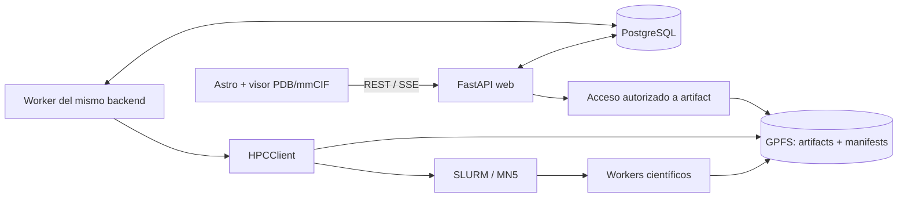

# Roadmap — Residue Annotation Platform, producto final

**Estado:** implementación incremental en curso; no es todavía release científico validado. **Puertos locales:** frontend 4742 / backend 8742. **Destino:** release de producto científico operativo, no solamente un scaffold. **Política de inspección:** VPN+SSH por contraseña, solo lectura en GPFS autorizado.

## 1. Qué significa «producto final»

Un usuario autorizado debe poder, con datos **reales**:

1. Registrar una proteína desde una secuencia/FASTA y resolver aliases UniProt, preservando una identidad interna por `sequence_sha256`.
2. Crear una run no bloqueante y ver el pipeline, sus estados y qué stages se reutilizan o se ejecutan.
3. Ejecutar con SLURM en MareNostrum 5 únicamente los stages científicamente faltantes; validar manifests, hashes, outputs y provenance antes de publicar resultados.
4. Explorar anotaciones por residuo canónico `aa_position` (1-based) + `aa_ref` mientras otros stages siguen activos, recibir eventos SSE y descargar evidencia con permisos.
5. Inspeccionar una estructura PDB/mmCIF en un visor molecular interactivo, seleccionar uno o varios residuos desde 3D/secuencia/tabla, sincronizar visualización y anotaciones, y distinguir numeración PDB de numeración canónica mediante mapping validado.
6. Compartir resultados científicos cuando la caché sea válida sin copiar artefactos, sin filtrar datos privados entre usuarios y con control de costo de cómputo.
7. Recuperarse de caída de web/worker/Slurm, cancelaciones y errores de GPFS; operar con auditoría, backups, pruebas científicas, seguridad y despliegue documentados.

Una demo con datos ficticios o un frontend bonito sin pipeline real **no cumple** la definición.

## 2. Arquitectura objetivo

- **Monorepo:** `frontend/` Astro + TypeScript; `backend/` FastAPI + Python; `compose.yml` para **desarrollo local**; especificaciones bajo `specs/`.
- **Organización por features:** `proteins`, `runs`, `stages`, `annotations`, `artifacts`, `viewer` (frontend). `db`, `core`, `infrastructure` sólo para responsabilidades transversales reales.
- **Un backend modular con dos procesos:** `web` (HTTP, REST, SSE, auth) y `worker` (pipeline, locks, caché, estado Slurm). Comparten código y PostgreSQL; **no son microservicios ni se comunican por HTTP**.
- **Una frontera pública:** el frontend sólo habla con FastAPI. No recibe rutas GPFS absolutas ni credenciales HPC.
- **Persistencia:** PostgreSQL conserva `protein`, `protein_identifier`, `run`, `run_stage`, `stage_result`, `artifact`, anotaciones tipadas y auditoría; GPFS conserva archivos grandes, logs, outputs y manifests.
- **HPCClient** interno encapsula la ejecución de jobs, con implementaciones `mock`, `ssh` por VPN+SSH y `native` si BSC autoriza acceso Slurm local; los workers científicos Slurm no necesitan credenciales PostgreSQL.
- **Inspección técnica de agentes/desarrolladores:** `ReadOnlyMN5Inspector` es un contrato **separado** del ejecutor; solo puede listar/consultar/leer parcialmente archivos existentes bajo `/gpfs/projects/bsc08/bsc001997/vcfs_1000geno/hilo_integrado_anotacion`. Nunca escribe, lanza comandos shell ni modifica jobs; no constituye una UI pública de archivos.
- **Entornos:** desarrollo local en Compose con perfil `vpn` (VPN + SSH/SCP) o perfil `mn5` dentro de MareNostrum (Slurm/GPFS local, sin VPN ni SSH); las passwords se mantienen en archivos protegidos. Producción dentro BSC es condicional a un servicio/VM permanente aprobado; GPFS+Slurm por sí mismos no son web hosting.
- **Resultado científico:** una entrada de `stage_result` puede satisfacer múltiples runs, siempre con `cache_key` completo, estado success y artefactos verificados.
- **Ciencia separada del servidor HTTP:** 18 stages semánticos con contrato por stage, `StageResult`, pipeline y manifest; no mover algoritmos al router.

La topología web/worker y el transporte a MN5 requieren ADR antes del despliegue. No se presupone ejecutar Docker Engine en nodos de cómputo.

## 3. Incrementos especificados y gates

| ID | Entrega | Dependencias | Gate |
| --- | --- | --- | --- |
| [0001 — Scaffold](specs/changes/0001-repository-scaffold/spec.md) | Astro/FastAPI/Compose de **dos** servicios, health, README | — | Arranque limpio y health web real |
| [0002 — Calidad](specs/changes/0002-repository-quality/spec.md) | pytest/Ruff/Astro check/CI, estándares | 0001 | Checks reproducibles, sin HPC |
| [0003 — Spike visor](specs/changes/0003-structure-viewer/spec.md) | Benchmark de librerías y selección PDB/mmCIF aislada | 0002 | Selection mapping real y ADR |
| [0004 — Proteínas](specs/changes/0004-protein-identity/spec.md) | PostgreSQL, Alembic, protein/aliases, FASTA/sha256 | 0002 | Duplicado resuelto a mismo protein_id |
| [0005 — Runs/modelo](specs/changes/0005-run-domain/spec.md) | run/run_stage/stage_result/artifact, endpoints | 0004 | Run durable, status/FK y no bloqueo |
| [0006 — Worker](specs/changes/0006-dag-worker/spec.md) | Entry point worker, pipeline, locks/leases, estados | 0005 | Reinicio y doble worker sin double-submit |
| [0007 — Baseline científica](specs/changes/0007-science-baseline/spec.md) | Snapshot + contratos 18 stages; inspección remota **solo lectura** opcional | 0002 | Equivalencia/comparación de datos reales sin modificar MN5 |
| [0008 — Caché/manifests](specs/changes/0008-cache-manifests/spec.md) | Claves, manifest final, validación y publicación | 0005, 0006, 0007 | Crash no publica success; cache correcto |
| [0009 — Slurm/GPFS + inspección segura](specs/changes/0009-hpc-gpfs/spec.md) | HPCClient mock/ssh/native e inspector SFTP read-only, VPN host + contraseña | 0006, 0008 | Smoke HPC real autorizado, SFTP confinado sin writes y manifest corrupto rechazado |
| [0010 — 18 stages](specs/changes/0010-scientific-integration/spec.md) | Migración científica por ramas / regresión | 0007, 0008, 0009 | Cada stage pasa golden smoke y provenance |
| [0011 — REST/SSE](specs/changes/0011-incremental-api/spec.md) | Annotations parciales, events, downloads | 0005, 0006, 0008 | UI/API re-sincroniza tras fallo de SSE |
| [0012 — Explorer integral](specs/changes/0012-residue-explorer/spec.md) | 3D+secuencia+tabla+tracks+QC/evidencia | 0003, 0010, 0011 | Selección bidireccional y mapping correcto |
| [0013 — Seguridad](specs/changes/0013-security-access/spec.md) | Autenticación, autorización, cuotas, audit, control de inspección read-only | 0004, 0005, 0011 | IDOR, secretos, límites GPFS, cuotas HPC |
| [0014 — Operación](specs/changes/0014-operations-deployment/spec.md) | Staging/prod, Linux/Windows, VPN host, recuperación, backups | 0010, 0011, 0013 | Restart/reconcile, VPN outage, restore y rollback |
| [0015 — Release](specs/changes/0015-product-release/spec.md) | E2E científico real, performance, security, sign-off | 0012, 0013, 0014 | Release aprobado con trazabilidad total |
| [0016 — Auth, inputs y concurrencia](specs/changes/0016-auth-account-security/spec.md) | Cuentas, sesiones, tokens, uploads pequeños y máximo una run activa por usuario | 0004, 0005, 0011 | Aceptación pending: PostgreSQL concurrente, proveedor email/SSO, secret scan, threat model y SCP autorizado |

**La spec de cada ID contiene** propuesta, requisitos observables, diseño preliminar, tareas y aceptación con estado `NOT RUN`. Aprobación de un ID **no** autoriza ejecutar los siguientes.

## 4. Entregas que un usuario podrá probar

- **R0 — Base de desarrollo:** 0001–0002; no es producto.
- **R1 — Catálogo + prototipo molecular:** 0003–0005; viewer real aislado y proteínas/runs persistentes, sin HPC aún.
- **R2 — Motor reproducible:** 0006–0008; pipeline, historial, baseline y manifest/caché en entorno controlado.
- **R3 — Piloto MN5:** 0009–0011; etapas científicas reales, Slurm/GPFS, resultados parciales y eventos.
- **R4 — Producto utilizable:** 0012–0013, 0016; explorador molecular conectado, control de acceso, cuentas y límite de concurrencia por usuario.
- **R5 — Producto final:** 0014–0015; recuperación, seguridad, pruebas de integración y aceptación final firmada.

No se asignan fechas ni presupuestos sin equipo, infraestructura, SLAs y política de GPU aprobados. Un gate puede bloquear entregas posteriores.

## 5. Requisitos científicos no negociables

- `aa_position` siempre canónica 1-based; `aa_ref` valida todos los merges per-residue.
- `NA` significa ausencia; **no es cero**, no es benigno ni significa que no se haya hecho el ensayo.
- Los valores de pLDDT / confianza AF3 **no** demuestran estabilidad, función o patogenicidad.
- Evidencia topológica TM concluyente no se reemplaza con baja confianza local; las reglas de conflicto de `structural_regime` se preservan.
- FoldX (kcal/mol) y RosettaMP (REU) no se suman/comparan como si fueran una misma energía.
- Manifest y caché por stage no alteran los outputs; un refactor debe comparar ciencia real antes/después.
- Todos los 18 stages tienen ficha en `specs/scientific-stages/`; `variant_ddg` es opcional.

## 6. Riesgos bloqueantes antes de codificar features críticas

Revisar [`specs/DECISIONS.md`](specs/DECISIONS.md) antes de 0007–0014: `reference_preparation` (PDF) frente a `protein_relaxation_energy` (pipeline documentado), `aa_annotations.tsv` frente a `annotations.tsv`, `legacy_id`, serialización de cache_key, autenticación y scopes, mapping PDB/mmCIF, transporte BSC y presupuesto de rendimiento.

No se resuelven por suposición. Hay que comparar con código/outputs y registrar ADR.

## 7. Definition of Done de producto final

1. E2E desde FASTA real y usuario autorizado hasta `run` finalizada/reutilizada, annotations, modelo 3D y descarga autorizada.
2. Repetición de la misma proteína no recalcula etapas válidas; cambio relevante invalida lo estrictamente necesario.
3. 18 etapas con regresión científica de referencia, contratos de versionado y fallos auditables.
4. Doble worker, crash de worker, `result_manifest.json` incompleto, cancelación, desconexión SSE y caída de red probados.
5. `aa_position` + `aa_ref`, mapping PDB, ausencia de información, unidades y QC sin interpretaciones engañosas.
6. Autorización server-side, aislamiento entre usuarios, secret scan, controles de cuotas HPC y audit log.
7. Restore DB y política de artefactos ensayados; despliegue y rollback en entorno aprobado.
8. Requisitos `MUST` trazados a pruebas con evidencia real (o excepciones aprobadas), revisión científica y operacional firmada.

**Estado ahora:** el checkout contiene una implementación local del plano de identidad, runs, DAG, API REST/SSE, artefactos, caché/manifiestos, worker y frontend conectado. No hay todavía producto científico final: los adapters de stages, baseline, smoke Slurm/GPFS, regresión, restore, seguridad operacional y aceptación E2E siguen pendientes según sus gates.

## 8. Desarrollo Linux/Windows y acceso de inspección a MareNostrum 5

El scaffold `0001` y la calidad `0002` **nunca** requieren VPN/HPC; todo debe funcionar con mocks. Cuando sea indispensable revisar la estructura del pipeline existente, manifests, outputs o logs, los agentes pueden solicitar acceso de lectura sobre la única ruta aprobada:

`/gpfs/projects/bsc08/bsc001997/vcfs_1000geno/hilo_integrado_anotacion`

**Perfil de conexión verificado manualmente el 2026-10-10:** VPN host `openfortivpn` a `gw.bsc.es:443` con password, luego SFTP `bsc001997@glogin4.bsc.es` con password y host key validada. No usar claves SSH inventadas, no asumir MFA ni acceso desde Windows sin validar routing/DNS desde Docker Desktop/WSL2. La VPN se mantiene fuera de FastAPI. `ReadOnlyMN5Inspector` usa SFTP read-only y paths relativos; no usar shell, SFTP write ni salir de la raíz. La política exige aprobación BSC para automatización y una identidad restringida para garantías fuertes a nivel SO. La conectividad manual y el inventario de código quedaron verificados; la implementación del inspector, los jobs y los resultados científicos siguen pendientes.

El uso de HPCClient para **submit/status/cancel** es distinto y solo se habilita en un change de ejecución autorizado; inspeccionar la carpeta nunca implica permiso para modificarla. No se incluye un browser GPFS en la web por esta instrucción; requeriría una futura spec de producto independiente.

| Perfil | Plataforma | HPC job | Inspección técnica |
| --- | --- | --- | --- |
| `mock` | Linux/Windows, CI | fake sin Slurm | fixtures read-only, sin secretos |
| `ssh` / `ssh_sftp` | Linux/Windows local | vía VPN+SSH autorizados | SFTP con `open('rb')`, sin remote exec |
| `native` | Infra BSC si se concede host persistente | Slurm local autorizado | GPFS montado con apertura read-only y permisos acotados |

**Referencia transversal:** [`specs/contracts/mn5-readonly-inspection.md`](specs/contracts/mn5-readonly-inspection.md). **Matriz de 18 pruebas:** [`specs/tests/mn5-readonly-inspection-matrix.md`](specs/tests/mn5-readonly-inspection-matrix.md). El pipeline se describe bajo `new/` pero el límite de inspección es exactamente la ruta padre proporcionada por el usuario. Todas las pruebas reales `NOT RUN` hasta autorización y conectividad.
