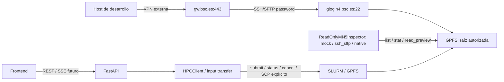

# Estado actual de MN5 y perfil de conectividad

**Fecha de corte:** 2026-10-14
**Estado:** documentación integrada; conectividad VPN/SSH verificada; inventario remoto de código y metadata de benchmark **VERIFIED / READ-ONLY**; baseline científico **PARCIAL**.
**Audiencia:** desarrollo, operación y revisión científica.

Este documento separa tres fuentes de información:

- **Verificado en este repositorio:** el estado del código que vive en `frontend/`, `backend/` y `compose.yml`.
- **Reportado por el equipo:** el bloque de configuración `HPC_*` recibido para la conexión a BSC/MN5.
- **Verificado remotamente por SFTP:** la raíz GPFS, su inventario de código/documentación y los contratos de los stages, sin ejecutar jobs ni modificar el filesystem.
- **Especificado pero no verificado:** resultados científicos, disponibilidad de binarios/GPU/cuota, aceptación institucional de automatización y ejecución real contra MN5. El checkout ya contiene las interfaces locales del cliente HPC, el inspector read-only y una frontera SCP para inputs pequeños; sus gates remotos siguen pendientes.

La VPN se levantó en el host y el perfil corregido `bsc001997@glogin4.bsc.es` abrió una sesión SFTP autenticada. La host key coincidió con una entrada ya existente en `~/.ssh/known_hosts`. La inspección se limitó a `pwd`, listados y lecturas de código/documentación dentro de la raíz autorizada; no se abrió shell remota, no se enviaron jobs y no se escribió en MN5.

## Perfil de conexión recibido

El siguiente perfil documenta los valores proporcionados. Las variables con `PASSWORD_FILE` son rutas a secretos, no contienen las contraseñas.

| Variable | Valor documentado | Uso | Estado |
| --- | --- | --- | --- |
| `HPC_VPN_HOST` | `gw.bsc.es` | Gateway VPN | Resuelto localmente; proceso VPN activo |
| `HPC_VPN_PORT` | `443` | Puerto del gateway VPN | Conectividad VPN observada |
| `HPC_VPN_USERNAME` | `mmenaca` | Usuario de la VPN | VPN levantada; no se documenta el secreto |
| `HPC_VPN_REQUIRED` | `true` | La conexión remota exige VPN | Requisito declarado |
| `HPC_SSH_HOST` | `glogin4.bsc.es` | Host de login SSH/SFTP | Resuelto y accesible por TCP/22 a través de la VPN |
| `HPC_SSH_PORT` | `22` | Puerto SSH | TCP/22 verificado y SFTP autenticado |
| `HPC_SSH_USERNAME` | `bsc001997` | Cuenta de login SSH | Autenticación SFTP verificada |
| `HPC_SSH_AUTH_METHOD` | `password` | Método de autenticación SSH | Autenticación SFTP verificada |
| `HPC_SSH_PASSWORD_FILE` | `/run/secrets/hpc_ssh_password` | Archivo secreto para SSH | Ruta absoluta ausente; fichero local ignorado con `0600` usado sin leerlo en pantalla |
| `HPC_VPN_PASSWORD_FILE` | `/run/secrets/hpc_vpn_password` | Archivo secreto para VPN | Ruta declarada; contenido ausente del repositorio |
| `HPC_POLL_INTERVAL_SECONDS` | `30` | Cadencia objetivo para consultar jobs | Configuración propuesta; no consumida por el código actual |

El nombre `HPC_*` es el perfil recibido para este repositorio. El contrato importado de inspección propone además nombres `MN5_*` (`MN5_SSH_USER`, `MN5_READONLY_ROOT`, etc.). No se deben asumir como alias automáticos: la normalización de nombres debe resolverse antes de implementar el change `0009` y quedar registrada en un ADR.

## Perímetro MN5 documentado

Los contratos importados fijan como única raíz de inspección técnica:

```text
/gpfs/projects/bsc08/bsc001997/vcfs_1000geno/hilo_integrado_anotacion
```

El subdirectorio `new/` aparece en la documentación como descendiente del perímetro permitido. La inspección actual confirma la raíz y su árbol de código/documentación observado, pero no constituye una validación de resultados científicos ni de permisos de escritura.

La inspección técnica observada es estrictamente distinta de la ejecución científica:



Reglas de frontera:

- En el perfil Compose `vpn`, la VPN vive en un contenedor aislado fuera de FastAPI y del frontend; en el perfil `mn5` no se inicia VPN porque el worker ya está dentro de MareNostrum.
- El inspector read-only no tiene shell remoto, `exec`, `sbatch`, `scancel` ni operaciones SFTP de escritura.
- El frontend nunca recibe credenciales, rutas GPFS absolutas ni comandos Slurm.
- La contraseña SSH no convierte por sí sola a una cuenta personal en una cuenta read-only a nivel del sistema operativo; esa garantía requiere ACL, cuenta de servicio o controles BSC aprobados.
- Un fallo de VPN/SFTP debe distinguirse de un fallo del job. El sistema futuro debe marcar indisponibilidad remota y reconciliar el job, no reenviarlo a ciegas.

## Qué existe hoy en el repositorio

La inspección local del código confirma el siguiente alcance:

| Componente | Evidencia | Estado respecto a MN5 |
| --- | --- | --- |
| API FastAPI | `backend/app/main.py`, `backend/app/features/*/router.py` | Expone catálogo, runs, SSE, artifacts, auth y uploads; no dispara por sí sola una ejecución científica real |
| Frontend Astro/Preact | `frontend/src/` | Onboarding y progreso conectados a la API; no contiene fixtures científicos de producto |
| Progreso del pipeline | `frontend/src/features/runs/components/progress/PipelineProgress.jsx` | Consulta la API/SSE persistida; no afirma que un stage tenga resultado sin `StageResult` |
| Compose | `compose.yml` | El perfil `vpn` levanta VPN, PostgreSQL, migraciones, API, `worker-vpn` y frontend; el perfil `mn5` sustituye el worker por `worker-mn5`, que usa Slurm/GPFS locales sin VPN ni SSH |
| Datos científicos locales | No se versionan fixtures de producto | El frontend no contiene artefactos científicos simulados; los resultados sólo llegan por el backend y los outputs MN5 aún no están publicados |
| Cliente HPC | `backend/app/infrastructure/hpc/{base,disabled,offline,ssh,native}.py` | Implementado como frontera local; el perfil `vpn` usa SSH/SCP y el perfil `mn5` usa Slurm local; el smoke de envío real sigue pendiente |
| Inspector read-only | `backend/app/infrastructure/hpc/readonly.py` | Implementado con paths confinados; smoke remoto y matriz completa siguen pendientes |
| Código científico remoto | raíz MN5 autorizada | Inspeccionado por SFTP: 19 paquetes de stage, 18 en el registro, documentación y tests; no ejecutado |

Por tanto, la variable `HPC_POLL_INTERVAL_SECONDS=30` describe una decisión operativa aún no conectada a un supervisor real. La API puede persistir y mostrar estados, pero eso no demuestra que haya un job ejecutándose en MN5.

## Último preflight de conectividad e inspección

El 2026-10-10 se completó el siguiente preflight y una inspección SFTP acotada:

- `openfortivpn`, `ssh` y `sftp` están instalados.
- `openfortivpn` está activo y existe `ppp0` con rutas BSC; el DNS recibido por la interfaz es `84.88.52.35/84.88.52.36`.
- `gw.bsc.es` resolvió a `84.88.52.240`.
- El alias inicial `glogin.bsc.es` no tiene respuesta DNS; el perfil corregido usa `glogin4.bsc.es`, que resolvió a `212.128.225.11` y aceptó TCP/22 por la VPN.
- La host key ED25519 `SHA256:c3d+hIywoqNHYQlYsmXFisK3wPXiPoGNS/V5NYFsvlQ` coincidió con `~/.ssh/known_hosts`; no se desactivó la validación ni se aceptó una clave nueva a ciegas.
- Se abrió SFTP con `bsc001997@glogin4.bsc.es`, usando autenticación por contraseña y sin shell remoto. `pwd` confirmó la sesión y los listados permitieron observar la raíz GPFS y su árbol de código/documentación.
- La raíz `/gpfs/projects/bsc08/bsc001997/vcfs_1000geno/hilo_integrado_anotacion` contiene `orchestration/`, `stages/`, `tests/`, `docs/`, `resources/`, `dependencies/`, `inputs/` y scripts de Slurm. Hay 19 paquetes bajo `stages/`; `orchestration/registry.py` registra 18 y `variant_structure_relaxation` queda standalone.
- Se leyeron contratos, adapters, cores/componentes seleccionados, documentación de stages y tests para producir el [inventario de código de stages](mn5-stage-code-inventory.md).
- No se ejecutó shell remota, Slurm, GPFS mutador, ningún stage ni smoke científico. No se validaron resultados, binarios, cuotas, GPUs o licencias.
- El fichero local ignorado `run/secrets/hpc_ssh_password` quedó con modo `0600`. El contenido no se leyó ni se registró.

El 2026-10-14 se ejecutó además el `SFTPReadOnlyInspector` del backend contra
la misma raíz autorizada, con `list` (55 entradas), `stat` y preview acotado de
`benchmarks/multinode_baseline_47265106/summary.tsv` (81 bytes). El smoke pasó
sin abrir shell, ejecutar Slurm ni escribir SFTP. Esto valida el transporte y
los límites del adaptador de aplicación; no sustituye la matriz completa ni
una ejecución científica.

En la misma fecha se inspeccionó, mediante el helper read-only del skill y cinco
archivos explícitos de metadata, el directorio remoto
`benchmarks/multinode_baseline_47265106/`. El snapshot SFTP terminó sin fallos
y verificó estos tamaños y hashes SHA-256:

| Archivo remoto | Bytes | SHA-256 | Lectura verificable |
| --- | ---: | --- | --- |
| `meta.json` | 413 | `0ff4b3b8751d09da2a347d5d2817a1d8f39431f70e07fd6721c75e464771873b` | job `47265106`, dos nodos, niveles `1/2/4/8`, presupuesto de 46 h |
| `dag_contracts.json` | 2,065 | `8d858cce27223e0612f3aca7bd5498a194d31fe60bc08608d80d2ffa409a9d2a` | dependencias y reservas CPU/GPU del DAG |
| `stages.tsv` | 4,506 | `c9e9a214475bd6282d0994c81fc1b54c6248ad44842c24eec08b529820e136b5` | 10 etapas de nivel 1 para `P01130`, todas `success`, `exit_code=0` |
| `summary.tsv` | 81 | `779d60c14abf8b79179f236dde3d9ec9373091715c4f67d3474374b0cc1ce40c` | sólo contiene el encabezado; no prueba una corrida completa |
| `code_sha256.tsv` | 19,130 | `6e0c7094959ce85983b5f7d71e81861ceaae4f3ced47945bd3f31855db2e5944` | relación de hashes del snapshot de código remoto |

La interpretación correcta es **ejecución parcial observada**, no baseline
científico aprobado: no hay resumen agregado de proteínas completadas, no se
compararon outputs/golden files y no se ejecutó ningún job desde este checkout.
Los paths de logs y muestras que aparecen en `stages.tsv` se conservaron como
referencia textual, pero no se descargaron sus contenidos ni datasets.

También se inspeccionaron benchmarks históricos ya existentes, sin ejecutar ni
modificar el pipeline. El resultado más informativo es
`benchmarks/all_stages_47143345/`: `config.json` declara una corrida de
`P01130` finalizada en 1,946.887 s, pero `stages.tsv` registra 16 filas de
nivel 1: 15 `success` y una `failed` en `conformational_ensemble`.
`profiles.tsv` confirma `returncode=1`, `success=15`, `failed=1` y cero
`cache_hits`. El archivo sólo cubre `pipeline17` de nivel 1; no prueba los
niveles configurados `4` y `16`, ni contiene un manifest/provenance completo
de la corrida ni los outputs necesarios para un golden baseline publicable.
Los hashes del snapshot fueron:

| Archivo remoto | Bytes | SHA-256 | Interpretación |
| --- | ---: | --- | --- |
| `benchmarks/all_stages_47143345/config.json` | 302 | `6d56610dbc8dc6924d56def015746e22d685d17fcfa6d12c88ac809f9db8d647` | corrida `P01130` finalizada, 80 CPU/4 GPU configuradas |
| `benchmarks/all_stages_47143345/stages.tsv` | 1,706 | `cc7d03ed3168affd8fed27df23e45b6cde568c1ab6de8d9d4e071c26606dc6b1` | 15 éxitos y 1 fallo en nivel 1 |
| `benchmarks/all_stages_47143345/profiles.tsv` | 243 | `f565b28151f6e3d2e05c247e568f64039b1f7ddd482aeb158d2a336c07944fb5` | retorno global `1`, sin hits de caché |
| `benchmarks/all_stages_47143345/telemetry.tsv` | 24,680 | `98a0dcfa95c7f9cefa8db24908b7e74d4e05558e4feab399d2bf3b2a5c370322` | telemetría sólo de nivel 1/pipeline17 |

Como evidencia adicional de la frontera de cache, se inspeccionó sólo el
resultado remoto de `protein_identity` que terminó con éxito dentro de
`all_stages_47143345/profile_01`. El snapshot SFTP explícito verificó `DONE`
(3 bytes, SHA-256
`a12b7cb43c9d9134b5bb1b35e9096b66775d9e92e7611d1cc92b02edd6782a87`),
`result_manifest.json` (3,956 bytes, SHA-256
`9524bc8a1f5c6b6de4108da335430d2591fa3ba8387ddb5c099264a1fd0b12c6`) y
`provenance.json` (4,141 bytes, SHA-256
`fb4da9f429c99334862edf607bd492fb5db73231ff8f28f93bd017ec263dfd3d`). El
manifest remoto declara `schema=stage-result-v1`,
`stage_id=protein_identity`, `status=success`, `partial=false`, 12 artefactos
locales y una clave de cache válida; el hash y tamaño de `provenance.json`
coinciden con `file_integrity`. El validador local
`validate_remote_manifest` aceptó esa metadata. En una segunda lectura
explícita y acotada se descargaron sólo `annotations.tsv` (15,407 bytes,
SHA-256 `a5c4dcfa102171bde737bedd8a6c9ba31d76c927c88e97c3458d7c5cb3d32c3c`),
`artifacts/protein_identity.tsv` (667 bytes, SHA-256
`8d11de561549d7af3cf362c6ff314e9a3c9b64347023daf90b740ce63de2b13a`) y
`artifacts/canonical_protein.fasta` (913 bytes, SHA-256
`7ba8cbf94ad91aef9999cc88ef289afcf9747acb78da3a6c37aa20fbec4bdefb`). La
tabla contiene 860 filas de `P01130` con cobertura exacta `1..860`; el
`aa_ref` coincide con la secuencia canónica de longitud 860 y la identidad
reporta el mismo SHA-256 de secuencia
`36a68c5510827c435b046def3dd5413c4715085cfdc1fdcb4b05a83e805ef3a2`. El
parser local de anotaciones aceptó las 860 filas. Esta evidencia prueba un
stage real y su forma de ingesta, pero no la ejecución completa ni la
equivalencia científica del benchmark.

Como control, `benchmarks/all_stages_47069621/config.json` declara otra corrida
finalizada, pero su `stages.tsv` de 51 bytes contiene sólo el encabezado; se
clasifica como evidencia incompleta, no como resultado científico. No se
descargaron datasets masivos ni outputs de etapas distintas de
`protein_identity`.

Para diagnosticar la corrida fallida se descargó únicamente el log de consola
`benchmarks/all_stages_47143345/profile_01/pipeline17.console.log` (21,826
bytes, SHA-256
`c2dcf2f0509821d95fd3e0618c9ddf7060c6091f90a83af735f1ba96b7c3d711`). El log
confirma `conformational_ensemble` con `cache MISS`, parámetros
`bioemu-v1.2`, `samples_per_round=250`, `min_retained=200` y
`max_rounds=20`, seguido de `command failed (1)`, y termina en
`status=partial_failed` con `ensemble_frustration=blocked`. El path temporal
de `ensemble.log` que el productor reporta ya no existe al consultarlo por
SFTP, por lo que la causa de bajo nivel no puede determinarse sin conservar el
artefacto de diagnóstico en MN5. Esto es una incidencia reproducible para el
dueño del pipeline, no una justificación para declarar equivalencia científica.

La inspección read-only del contrato actual de
`stages/conformational_ensemble/contract.py` (751 bytes, SHA-256
`042f6f00b29a2458d01d85d1e7b74bb2b88bba5a9101ec593ff0eebd881faf70`) declara
explícitamente `dependencies=("protein_identity", "structure_modeling")`,
`gpu=1` y el requisito técnico `msa_cache`; coincide con el registry local.
Sin embargo, el log histórico de `pipeline17` imprimió
`READY ... deps=protein_identity` y `gpu=0` para ese mismo stage. Esas
discrepancias entre el contrato observado y la planificación/recursos de la
corrida impiden usarla como prueba de ejecución válida del DAG: antes de una
aceptación científica se debe repetir la corrida con una versión fijada y
demostrar que el scheduler espera `structure_modeling`, su `msa_cache_entry` y
la reserva GPU declarada.

Esta inspección es evidencia de conectividad, permisos de lectura y estructura de código en la raíz observada. No es evidencia de ejecución científica, de permisos de escritura ni de aceptación operativa del pipeline.

## Manejo de secretos

El repositorio debe contener únicamente rutas a secretos o nombres de variables, nunca el contenido de las contraseñas.

- No poner contraseñas en `.env`, argumentos de línea de comandos, imágenes Docker, commits, logs ni trazas de debug.
- Mantener los archivos `/run/secrets/hpc_ssh_password` y `/run/secrets/hpc_vpn_password` fuera del repositorio y bajo controles del sistema operativo.
- Verificar la identidad del gateway VPN y la host key SSH desde una fuente institucional confiable; no desactivar validación TLS ni usar un `known_hosts` vacío.
- La aplicación actual no lee estas rutas ni intenta elevar privilegios con `sudo`.
- CI y desarrollo offline deben continuar usando mocks sin VPN, SSH, GPFS o `SLURM_JOB_ID`.

## Evidencia todavía pendiente

La siguiente información no está verificada y no debe presentarse como disponible:

- ejecución de una corrida o de un stage con entradas científicas aprobadas;
- manifests, logs, outputs y provenance completos de todas las etapas producidos
  por una corrida real desde este checkout;
- finalización del baseline `47265106`: el metadata y diez etapas parciales son observables, pero `summary.tsv` no contiene filas de proteína completada;
- resolución reproducible del fallo `conformational_ensemble` observado en `all_stages_47143345` y una corrida completa de los niveles configurados;
- versiones ejecutables, módulos, licencias, GPUs, cuotas y disponibilidad de cachés;
- acceso a Slurm, estado de jobs y tiempos de polling;
- permisos read-only a nivel BSC/OS para una cuenta de servicio y política para automatización;
- ejecución real de `HPCClient` contra Slurm/MN5, incluido el SCP de uploads pequeños;
- aceptación de un `ReadOnlyMN5Inspector` contra el entorno autorizado y la matriz completa de casos.

La matriz [MN5 read-only](../specs/tests/mn5-readonly-inspection-matrix.md) conserva en `NOT RUN` los casos de aceptación formal del inspector porque el smoke anterior no cubre todos los escenarios ni constituye aprobación institucional. El checkout implementa drivers local/native, SFTP y mock con límites de lectura; `build_read_only_inspector` exige habilitación explícita y no hace fallback entre perfiles. Los casos mutadores se prueban únicamente en un laboratorio aislado y nunca sobre datos reales.

## Próximo límite de implementación

Antes de activar cualquier conexión real, el equipo debe aprobar el change `0009` y resolver los ADR de transporte, credenciales, perímetro GPFS y hosting BSC. La implementación debe mantener dos interfaces separadas:

1. `ReadOnlyMN5Inspector` para listar, consultar metadata y leer previews acotados de archivos existentes; `build_read_only_inspector` selecciona explícitamente el driver `mock`, `ssh_sftp` o `native`.
2. `HPCClient` para ejecución científica, estado y cancelación de jobs, con permisos y aceptación independientes.

Este documento no autoriza jobs ni inspección remota; solo registra el perfil recibido y el límite actual del producto. El código de transferencia SCP permanece desactivado por configuración hasta que exista autorización explícita y host key/secretos válidos.

## Referencias del plan

- [Roadmap del producto](../ROADMAP.md)
- [Contrato de inspección MN5 read-only](../specs/contracts/mn5-readonly-inspection.md)
- [Runbook de acceso read-only](../specs/runbooks/mn5-readonly-access.md)
- [Contrato HPC, manifests y caché](../specs/contracts/hpc-manifest-cache.md)
- [Inventario del código de stages observado en MN5](mn5-stage-code-inventory.md)
- [Decisiones abiertas](../specs/DECISIONS.md)
