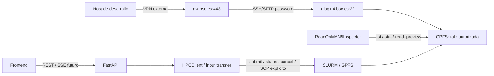

# Estado actual de MN5 y perfil de conectividad

**Fecha de corte:** 2026-10-10  
**Estado:** documentación integrada; conectividad VPN/SSH verificada; inventario remoto de código **VERIFIED / READ-ONLY**.  
**Audiencia:** desarrollo, operación y revisión científica.

Este documento separa tres fuentes de información:

- **Verificado en este repositorio:** el estado del código que vive en `frontend/`, `backend/` y `compose.yml`.
- **Reportado por el equipo:** el bloque de configuración `HPC_*` recibido para la conexión a BSC/MN5.
- **Verificado remotamente por SFTP:** la raíz GPFS, su inventario de código/documentación y los contratos de los stages, sin ejecutar jobs ni modificar el filesystem.
- **Especificado pero no verificado:** resultados científicos, disponibilidad de binarios/GPU/cuota, aceptación institucional de automatización y ejecución real contra MN5. El checkout ya contiene las interfaces locales del cliente HPC, el inspector read-only y una frontera SCP para inputs pequeños; sus gates remotos siguen pendientes.

La VPN se levantó en el host y el perfil corregido `bsc001997@glogin4.bsc.es` abrió una sesión SFTP autenticada. La host key coincidió con una entrada ya existente en `~/.ssh/known_hosts`. La inspección se limitó a `pwd`, listados y lecturas de código/documentación dentro de la raíz autorizada; no se abrió shell remota, no se enviaron jobs y no se escribió en MN5.

## Perfil de conexión recibido

El siguiente perfil documenta los valores proporcionados. Las variables con `PASSWORD_FILE` son rutas a secretos, no contienen las contraseñas.

| Variable | Valor documentado | Uso | Estado |
| --- | --- | --- | --- |
| `HPC_VPN_HOST` | `gw.bsc.es` | Gateway VPN | Resuelto localmente; proceso VPN activo |
| `HPC_VPN_PORT` | `443` | Puerto del gateway VPN | Conectividad VPN observada |
| `HPC_VPN_USERNAME` | `mmenaca` | Usuario de la VPN | VPN levantada; no se documenta el secreto |
| `HPC_VPN_REQUIRED` | `true` | La conexión remota exige VPN | Requisito declarado |
| `HPC_SSH_HOST` | `glogin4.bsc.es` | Host de login SSH/SFTP | Resuelto y accesible por TCP/22 a través de la VPN |
| `HPC_SSH_PORT` | `22` | Puerto SSH | TCP/22 verificado y SFTP autenticado |
| `HPC_SSH_USERNAME` | `bsc001997` | Cuenta de login SSH | Autenticación SFTP verificada |
| `HPC_SSH_AUTH_METHOD` | `password` | Método de autenticación SSH | Autenticación SFTP verificada |
| `HPC_SSH_PASSWORD_FILE` | `/run/secrets/hpc_ssh_password` | Archivo secreto para SSH | Ruta absoluta ausente; fichero local ignorado con `0600` usado sin leerlo en pantalla |
| `HPC_VPN_PASSWORD_FILE` | `/run/secrets/hpc_vpn_password` | Archivo secreto para VPN | Ruta declarada; contenido ausente del repositorio |
| `HPC_POLL_INTERVAL_SECONDS` | `30` | Cadencia objetivo para consultar jobs | Configuración propuesta; no consumida por el código actual |

El nombre `HPC_*` es el perfil recibido para este repositorio. El contrato importado de inspección propone además nombres `MN5_*` (`MN5_SSH_USER`, `MN5_READONLY_ROOT`, etc.). No se deben asumir como alias automáticos: la normalización de nombres debe resolverse antes de implementar el change `0009` y quedar registrada en un ADR.

## Perímetro MN5 documentado

Los contratos importados fijan como única raíz de inspección técnica:

```text
/gpfs/projects/bsc08/bsc001997/vcfs_1000geno/hilo_integrado_anotacion
```

El subdirectorio `new/` aparece en la documentación como descendiente del perímetro permitido. La inspección actual confirma la raíz y su árbol de código/documentación observado, pero no constituye una validación de resultados científicos ni de permisos de escritura.

La inspección técnica observada es estrictamente distinta de la ejecución científica:



Reglas de frontera:

- La VPN se administra en el host, fuera de FastAPI y fuera del frontend.
- El inspector read-only no tiene shell remoto, `exec`, `sbatch`, `scancel` ni operaciones SFTP de escritura.
- El frontend nunca recibe credenciales, rutas GPFS absolutas ni comandos Slurm.
- La contraseña SSH no convierte por sí sola a una cuenta personal en una cuenta read-only a nivel del sistema operativo; esa garantía requiere ACL, cuenta de servicio o controles BSC aprobados.
- Un fallo de VPN/SFTP debe distinguirse de un fallo del job. El sistema futuro debe marcar indisponibilidad remota y reconciliar el job, no reenviarlo a ciegas.

## Qué existe hoy en el repositorio

La inspección local del código confirma el siguiente alcance:

| Componente | Evidencia | Estado respecto a MN5 |
| --- | --- | --- |
| API FastAPI | `backend/app/main.py`, `backend/app/features/*/router.py` | Expone catálogo, runs, SSE, artifacts, auth y uploads; no dispara por sí sola una ejecución científica real |
| Frontend Astro/Preact | `frontend/src/` | Onboarding y progreso conectados a la API; no contiene fixtures científicos de producto |
| Progreso del pipeline | `frontend/src/features/runs/components/progress/PipelineProgress.jsx` | Consulta la API/SSE persistida; no afirma que un stage tenga resultado sin `StageResult` |
| Compose | `compose.yml`, `compose.ssh.yml` | `docker compose up` levanta PostgreSQL, migraciones, API, worker y frontend. El overlay SSH monta secretos sólo cuando se pide. VPN/SFTP/Slurm siguen fuera de Compose |
| Datos científicos locales | No se versionan fixtures de producto | El frontend no contiene artefactos científicos simulados; los resultados sólo llegan por el backend y los outputs MN5 aún no están publicados |
| Cliente HPC | `backend/app/infrastructure/hpc/{base,disabled,offline,ssh,native}.py` | Implementado como frontera local; submit/status/cancel real y smoke MN5 siguen pendientes |
| Inspector read-only | `backend/app/infrastructure/hpc/readonly.py` | Implementado con paths confinados; smoke remoto y matriz completa siguen pendientes |
| Código científico remoto | raíz MN5 autorizada | Inspeccionado por SFTP: 19 paquetes de stage, 18 en el registro, documentación y tests; no ejecutado |

Por tanto, la variable `HPC_POLL_INTERVAL_SECONDS=30` describe una decisión operativa aún no conectada a un supervisor real. La API puede persistir y mostrar estados, pero eso no demuestra que haya un job ejecutándose en MN5.

## Último preflight de conectividad e inspección

El 2026-10-10 se completó el siguiente preflight y una inspección SFTP acotada:

- `openfortivpn`, `ssh` y `sftp` están instalados.
- `openfortivpn` está activo y existe `ppp0` con rutas BSC; el DNS recibido por la interfaz es `84.88.52.35/84.88.52.36`.
- `gw.bsc.es` resolvió a `84.88.52.240`.
- El alias inicial `glogin.bsc.es` no tiene respuesta DNS; el perfil corregido usa `glogin4.bsc.es`, que resolvió a `212.128.225.11` y aceptó TCP/22 por la VPN.
- La host key ED25519 `SHA256:c3d+hIywoqNHYQlYsmXFisK3wPXiPoGNS/V5NYFsvlQ` coincidió con `~/.ssh/known_hosts`; no se desactivó la validación ni se aceptó una clave nueva a ciegas.
- Se abrió SFTP con `bsc001997@glogin4.bsc.es`, usando autenticación por contraseña y sin shell remoto. `pwd` confirmó la sesión y los listados permitieron observar la raíz GPFS y su árbol de código/documentación.
- La raíz `/gpfs/projects/bsc08/bsc001997/vcfs_1000geno/hilo_integrado_anotacion` contiene `orchestration/`, `stages/`, `tests/`, `docs/`, `resources/`, `dependencies/`, `inputs/` y scripts de Slurm. Hay 19 paquetes bajo `stages/`; `orchestration/registry.py` registra 18 y `variant_structure_relaxation` queda standalone.
- Se leyeron contratos, adapters, cores/componentes seleccionados, documentación de stages y tests para producir el [inventario de código de stages](mn5-stage-code-inventory.md).
- No se ejecutó shell remota, Slurm, GPFS mutador, ningún stage ni smoke científico. No se validaron resultados, binarios, cuotas, GPUs o licencias.
- El fichero local ignorado `run/secrets/hpc_ssh_password` quedó con modo `0600`. El contenido no se leyó ni se registró.

El 2026-10-14 se ejecutó además el `SFTPReadOnlyInspector` del backend contra
la misma raíz autorizada, con `list` (55 entradas), `stat` y preview acotado de
`benchmarks/multinode_baseline_47265106/summary.tsv` (81 bytes). El smoke pasó
sin abrir shell, ejecutar Slurm ni escribir SFTP. Esto valida el transporte y
los límites del adaptador de aplicación; no sustituye la matriz completa ni
una ejecución científica.

Esta inspección es evidencia de conectividad, permisos de lectura y estructura de código en la raíz observada. No es evidencia de ejecución científica, de permisos de escritura ni de aceptación operativa del pipeline.

## Manejo de secretos

El repositorio debe contener únicamente rutas a secretos o nombres de variables, nunca el contenido de las contraseñas.

- No poner contraseñas en `.env`, argumentos de línea de comandos, imágenes Docker, commits, logs ni trazas de debug.
- Mantener los archivos `/run/secrets/hpc_ssh_password` y `/run/secrets/hpc_vpn_password` fuera del repositorio y bajo controles del sistema operativo.
- Verificar la identidad del gateway VPN y la host key SSH desde una fuente institucional confiable; no desactivar validación TLS ni usar un `known_hosts` vacío.
- La aplicación actual no lee estas rutas ni intenta elevar privilegios con `sudo`.
- CI y desarrollo offline deben continuar usando mocks sin VPN, SSH, GPFS o `SLURM_JOB_ID`.

## Evidencia todavía pendiente

La siguiente información no está verificada y no debe presentarse como disponible:

- ejecución de una corrida o de un stage con entradas científicas aprobadas;
- manifests, logs, outputs y provenance producidos por una corrida real;
- versiones ejecutables, módulos, licencias, GPUs, cuotas y disponibilidad de cachés;
- acceso a Slurm, estado de jobs y tiempos de polling;
- permisos read-only a nivel BSC/OS para una cuenta de servicio y política para automatización;
- ejecución real de `HPCClient` contra Slurm/MN5, incluido el SCP de uploads pequeños;
- aceptación de un `ReadOnlyMN5Inspector` contra el entorno autorizado y la matriz completa de casos.

La matriz [MN5 read-only](../specs/tests/mn5-readonly-inspection-matrix.md) conserva en `NOT RUN` los casos de aceptación formal del inspector porque el smoke anterior no cubre todos los escenarios ni constituye aprobación institucional. El checkout sí implementa la interfaz local/SFTP con límites de lectura; los casos mutadores se prueban únicamente en un laboratorio aislado y nunca sobre datos reales.

## Próximo límite de implementación

Antes de activar cualquier conexión real, el equipo debe aprobar el change `0009` y resolver los ADR de transporte, credenciales, perímetro GPFS y hosting BSC. La implementación debe mantener dos interfaces separadas:

1. `ReadOnlyMN5Inspector` para listar, consultar metadata y leer previews acotados de archivos existentes.
2. `HPCClient` para ejecución científica, estado y cancelación de jobs, con permisos y aceptación independientes.

Este documento no autoriza jobs ni inspección remota; solo registra el perfil recibido y el límite actual del producto. El código de transferencia SCP permanece desactivado por configuración hasta que exista autorización explícita y host key/secretos válidos.

## Referencias del plan

- [Roadmap del producto](../ROADMAP.md)
- [Contrato de inspección MN5 read-only](../specs/contracts/mn5-readonly-inspection.md)
- [Runbook de acceso read-only](../specs/runbooks/mn5-readonly-access.md)
- [Contrato HPC, manifests y caché](../specs/contracts/hpc-manifest-cache.md)
- [Inventario del código de stages observado en MN5](mn5-stage-code-inventory.md)
- [Decisiones abiertas](../specs/DECISIONS.md)
