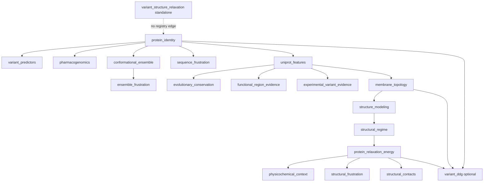
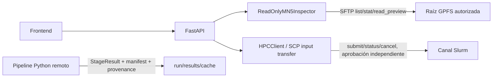

# Inventario del código de stages en MN5

**Fecha de inspección:** 2026-10-10  
**Estado:** VERIFIED — inspección remota de código y documentación, exclusivamente de lectura  
**Audiencia:** desarrollo, operación y revisión científica  
**Fuente observada:** `/gpfs/projects/bsc08/bsc001997/vcfs_1000geno/hilo_integrado_anotacion`

Este documento complementa la especificación del producto con el estado que realmente tiene el pipeline desplegado en MN5. No describe una implementación local del producto web: el checkout de este repositorio contiene un scaffold FastAPI/Astro sin datos científicos de producto, mientras que el directorio remoto contiene el pipeline científico Python que se debe integrar.

## Cómo se obtuvo la evidencia

La inspección se realizó después de activar la VPN del host y autenticar por SFTP usando el perfil corregido:

| Elemento | Valor | Estado |
| --- | --- | --- |
| Gateway VPN | `gw.bsc.es:443` | Verificado; interfaz `ppp0` activa durante la sesión |
| Usuario VPN | `mmenaca` | Verificado como perfil de conexión; el secreto no se documenta |
| Host de login | `glogin4.bsc.es:22` | Verificado; resuelve y acepta TCP/22 por la VPN |
| Usuario SSH | `bsc001997` | Verificado; autenticación SFTP exitosa |
| Transporte | SFTP, sin shell remota | Verificado |
| Host key | ED25519 `SHA256:c3d+hIywoqNHYQlYsmXFisK3wPXiPoGNS/V5NYFsvlQ` | Coincide con `~/.ssh/known_hosts` |
| Operaciones | `pwd`, listados y lecturas acotadas | Verificado |
| Escrituras remotas | Ninguna | Verificado por procedimiento |
| Jobs/Slurm | No se ejecutaron | Verificado por procedimiento |

Se descargó únicamente una copia temporal y acotada de código fuente, contratos y documentación necesaria para correlacionar los stages. No se copiaron secretos, resultados científicos masivos, cachés, recursos pesados ni archivos de datos de usuarios. No se ejecutó `ssh`, `sbatch`, `salloc`, `scancel`, ningún stage ni ningún script remoto.

La autoridad de cada afirmación es, en este orden:

1. `stages/<stage>/stage.py`, `contract.py`, `config.py`, `core.py` y `orchestration/` observados remotamente.
2. Tests y documentación `docs/` observados remotamente.
3. El roadmap y las specs del checkout local, que expresan el objetivo de integración.

La presencia de un contrato, test o wrapper no demuestra que una corrida científica concreta haya terminado correctamente. La ejecución real y los valores producidos siguen sin verificarse.

## Inventario del repositorio remoto

La raíz observada contiene:

- `main.py` y `smoke_all_stages.py` como entradas del pipeline y del smoke local del pipeline.
- `orchestration/` con contexto de corrida, registro, resolución de dependencias del pipeline, caché, provenance, preflight, mapeo de coordenadas/genómico, scheduler y ejecución.
- `stages/` con 19 paquetes científicos.
- `tests/` con cobertura de contratos, adaptadores, runtime, recursos y orquestación.
- `docs/` con documentación de operación y documentación específica de 18 stages.
- `inputs/variants/` y varios scripts `*.sbatch`/de lanzamiento.
- `resources/` con recursos de evidencia, predictores, farmacogenómica, MANE/Ensembl y relajación.
- `dependencies/` con runtimes y herramientas como AlphaFold 3, BioEmu, Arpeggio, CD-HIT, DSSP, FoldX, Frustratometer, FrustraSeq, PharmCAT, rate4site y FreeSASA.

Hay **19 directorios de stage**, pero el registro principal expone **18 IDs**. El paquete adicional es `variant_structure_relaxation`: su propio contrato lo describe como utilidad standalone por PDB y advierte que no debe añadirse al registro hasta representar explícitamente sus entradas por ruta en el contrato principal.

## Registro principal y pipeline observado

`orchestration/registry.py` define exactamente este registro, en este orden de preferencia para desempates topológicos:

```text
protein_identity
variant_predictors
pharmacogenomics
conformational_ensemble
ensemble_frustration
sequence_frustration
uniprot_features
evolutionary_conservation
functional_region_evidence
experimental_variant_evidence
membrane_topology
structure_modeling
structural_regime
protein_relaxation_energy
physicochemical_context
variant_ddg
structural_frustration
structural_contacts
```

Las dependencias declaradas por los contratos producen el siguiente grafo de dependencias del pipeline. Las flechas son dependencias científicas del registro, no necesariamente todas las precondiciones técnicas de caché o de scheduler:



## Matriz de stages observados

La matriz combina el `StageSpec` remoto con la entrada `stage.py` y la documentación específica. `CPU/GPU/red` son los recursos declarados en el contrato, no una medición de consumo real. `Anotaciones` son columnas proyectadas a `annotations.tsv`; `Artefactos` son claves del resultado del stage.

| ID | Dependencias | Entrada/propósito observado | Anotaciones declaradas | Artefactos declarados | Recursos y gates declarados |
| --- | --- | --- | --- | --- | --- |
| `protein_identity` | — | Construye el andamio canónico 1-based, identidad, MANE, transcripts y diferencias de secuencia. | `gene` | `canonical_fasta`, `protein_identity`, `transcripts`, `query_fasta`, `reference_mane_fasta`, `mane_reference`, `sifts_mapping`, `sequence_comparison`, `sequence_assessment`, `engineered_mutations`, `detected_variants`, `unresolved_differences` | `1 CPU`, sin GPU/red; sin requisito técnico declarado |
| `variant_predictors` | `protein_identity` | Agrega AlphaMissense, CADD y REVEL para sustituciones missense posibles usando recursos locales y mapeo genómico. | `alphamissense_mean`, `alphamissense_max`, `cadd_phred_mean`, `revel_mean` | `predictor_per_position`, `predictor_substitutions`, `transcript_mapping`, `metadata` | `4 CPU`, sin GPU/red; `genomic_mapping` |
| `pharmacogenomics` | `protein_identity` | Cruza PharmCAT/PharmVar/PharmGKB con coordenadas y aminoácidos canónicos; comparte el mapeo genómico, no resultados de predictores. | `pgx_star_alleles`, `pgx_allele_function`, `pgx_gene_evidence_level` | `pgx_per_position`, `pgx_alleles`, `metadata`, `genomic_mapping`, `genomic_substitutions` | `1 CPU`, sin GPU/red; `genomic_mapping` |
| `conformational_ensemble` | `protein_identity` | Genera y filtra un ensemble de referencia con BioEmu. Requiere MSA `af3-msa-v1` como prerrequisito técnico; no publica columnas por residuo. | — | `conformational_ensemble_final_dir`, `metadata`, `frames_index`, `ensemble_aligned_ca`, `ensemble_flat_ca`, `topology`, `ensemble_cache`, `msa_manifest`, `log` | `4 CPU`, `1 GPU`, sin red; `msa_cache` |
| `ensemble_frustration` | `conformational_ensemble` | Ejecuta Frustratometer por conformero retenido y publica la media de frustración por residuo. | `frustratometer_mean` | `frustratometer_conformers`, `frustratometer_per_residue`, `metadata`, `closure`, `helper_log` | `4 CPU`, sin GPU/red |
| `sequence_frustration` | `protein_identity` | Calcula frustración de secuencia con FrustraSeq/FrustrAI-Seq a partir del FASTA canónico. No usa PDB ni MSA. | `frustraiseq_index`, `frustraiseq_class`, `frustraiseq_entropy`, `frustraiseq_surprisal` | `frustraiseq_per_residue`, `metadata` | `2 CPU`, `1 GPU`, sin red |
| `uniprot_features` | `protein_identity` | Proyecta UniProt e InterPro sobre residuos canónicos usando JSON externos; en Slurm es cache-only. | `uniprot_domain`, `uniprot_active_site`, `uniprot_binding_site`, `uniprot_ptm`, `uniprot_disulfide_partner`, `uniprot_topology`, `in_metal_site`, `interpro_entries`, `interpro_status`, `uniprot_mapping_status` | `uniprot_coordinate_mapping`, `functional_features_long` | `1 CPU`, sin GPU, red declarada; `external_cache` |
| `evolutionary_conservation` | `uniprot_features` | Construye evidencia de homólogos desde búsqueda/caché y calcula conservación con rate4site/Consurf y QC. | `rate4site_score`, `consurf_grade` | `evolution_per_residue`, `metadata` | `1 CPU`, sin GPU, red declarada; `homology_access_or_cache` |
| `functional_region_evidence` | `uniprot_features` | Marca regiones curatoriales LDL-C/statin con un recurso local y el mapping de UniProt. | `variant_in_statin_ldlc_region` | `ldlc_statin_evidence`, `summary` | `1 CPU`, sin GPU/red |
| `experimental_variant_evidence` | `uniprot_features` | Resume ensayos missense de MaveDB por posición canónica; en cómputo usa caché. No interpreta patogenicidad. | `mavedb_position_assayed`, `mavedb_n_score_sets`, `mavedb_n_substitutions_tested` | `mavedb_details` | `1 CPU`, sin GPU, red declarada; `mavedb_access_or_cache` |
| `membrane_topology` | `uniprot_features` | Ejecuta TMbed formato 3 y materializa topología, segmentos y span si la topología es compatible con RosettaMP. | `tmbed_topology` | `raw_prediction`, `tmbed_per_residue`, `tm_segments`, `span`, `span_metadata` | `4 CPU`, `1 GPU`, sin red |
| `structure_modeling` | `membrane_topology` | Ejecuta o reutiliza AlphaFold 3 y valida correspondencia residuo a residuo, coordenadas y pLDDT. | `structure_qc_status` | `model_cif`, `msa_cache_entry`, `af3_confidence_per_residue`, `structure_qc_per_residue`, `alphafold_dir` | `8 CPU`, `1 GPU`, sin red |
| `structural_regime` | `structure_modeling` | Combina topología UniProt/TMbed y QC estructural con reglas deterministas (`membrane`, `aqueous_folded`, `structurally_uncertain`). | `structural_regime`, `structural_regime_rule`, `topology_agreement` | `structural_regime_detail` | `1 CPU`, sin GPU/red |
| `protein_relaxation_energy` | `structural_regime` | Prepara la referencia WT y energías con FoldX y/o Rosetta según modo (`auto`, `foldx`, `rosetta`, `both`; por defecto `both`). | `rosetta_relaxation_status`, `foldx_relaxation_status`, `rosetta_energy_value`, `foldx_energy_value` | `structure_mapping`, `selected_reference_pdb`, `selected_reference_json`, `provenance` | `20 CPU`, sin GPU/red; el runtime Rosetta MPI requiere `SLURM_JOB_ID` y `srun` |
| `physicochemical_context` | `protein_relaxation_energy` | Calcula secundaria con DSSP y SASA/enterramiento con FreeSASA sobre la estructura elegida. | `secondary_structure`, `buried_status` | `dssp_per_residue`, `sasa_per_residue`, `physicochemical_context_detail` | `4 CPU`, sin GPU/red |
| `variant_ddg` | `protein_identity`, `membrane_topology`, `protein_relaxation_energy` | Stage opcional para sustituciones resueltas; el entrypoint registrado actual usa runtime Rosetta con scoring WT/MUT emparejado. `--variant` queda como compatibilidad manual. | `ddg_variant_evaluated` | `variant_annotations`, `ddg_replicates`, `provenance`, `variant_dir`, `rosetta_metadata`, `variant_set` | `4 CPU`, sin GPU/red; el contrato no declara `SLURM_JOB_ID`, aunque el launcher puede usar `srun` dentro de una asignación |
| `structural_frustration` | `protein_relaxation_energy` | Calcula frustración estructural WT con Frustratometer/R y resume índices y contactos en ventana de 5 residuos. | `structural_frustration_fi_singleresidue`, `structural_frustration_fi_singleresidue_window5_mean`, `structural_frustration_fi_singleresidue_window5_median`, `structural_frustration_fi_configurational`, `structural_frustration_fi_mutational`, seis campos `structural_frustration_n_contacts_*`, `structural_frustration_status` | `frustration_per_residue`, `structure_index`, `provenance`, `native_output_dir` | `4 CPU`, sin GPU/red |
| `structural_contacts` | `protein_relaxation_energy` | Resume contactos WT de Arpeggio, mapeados al andamio canónico; no compara WT/MUT. | `structural_contacts_n_contacts`, `structural_contacts_n_partner_residues`, `structural_contacts_contact_types`, `structural_contacts_status`, `structural_contacts_qc_reason` | `contact_residue_summary`, `contacts_long`, `structure_index`, `provenance`, `arpeggio_json`, `arpeggio_log` | `4 CPU`, sin GPU/red; el core exige `SLURM_JOB_ID` antes de llamar a Arpeggio |
| `variant_structure_relaxation` | No está en el registro | Utilidad standalone: muta variantes presentes en un PDB suministrado y relaja cada mutante con Rosetta FastRelax. | — | `variant_manifest`, `provenance`, `variants_dir` | `4 CPU`, sin GPU/red; `SLURM_JOB_ID` declarado |

## Contrato común de ejecución

### Contexto y materiales de entrada

`orchestration.context.RunContext` concentra la identidad de la proteína, las secuencias query/reference, el hash de secuencia, MANE, estado de entrada, recursos farmacogenómicos congelados y los resultados previos. También ofrece `annotations(stage_id)`, `artifact(stage_id, key)` y `materialize(stage_ids, name)` para construir tablas intermedias desde `annotations.tsv`.

El ejecutor:

1. Resuelve el registro y la selección con dependencias, opciones, rangos y skips.
2. Ordena el subconjunto topológicamente y puede calcular ondas paralelas.
3. Ejecuta cada `stage.py` en un workspace temporal con `logs/` y `artifacts/`.
4. Inyecta `ASSIGNED_CPUS`, `CUDA_VISIBLE_DEVICES` y `PIPELINE_FORCE_THIS_STAGE`.
5. Exige un `StageResult` y normaliza el workspace final.
6. Valida el andamio canónico y las columnas declaradas.
7. Registra artefactos, provenance operativa, manifest de resultado y clave de caché.

Los adapters publican normalmente mediante `stages._adapter_utils.publish`: crean `annotations.tsv`, proyectan solo las columnas declaradas y devuelven las rutas de artefactos. El stage de ensemble usa `copy_scaffold` porque no produce anotaciones. En consecuencia, una integración futura debe consumir `StageResult`/manifest y no interpretar nombres de archivos de forma ad hoc.

### Cachés y red

La política observada separa preparación externa de ejecución científica:

- `uniprot_features` e InterPro leen JSON de `cache/uniprot/` y `cache/interpro/`; `--prepare-external` llena esa caché fuera de la corrida.
- `experimental_variant_evidence` usa una caché de MaveDB; la documentación nombra la API `https://api.mavedb.org/api/v1`, pero un job de Slurm no debe descargar.
- `evolutionary_conservation` necesita homólogos o una caché aprobada.
- MSA `af3-msa-v1` es un prerrequisito técnico compartido por AlphaFold 3 y BioEmu; ambos fallan en preflight si no hay entrada válida y no se inyecta un generador.
- Predictores de variantes, PharmCAT/PharmVar/PharmGKB y la evidencia LDL-C/statin usan recursos locales del proyecto.

La presencia de `network=True` en un `ResourceSpec` describe la capacidad declarada para una etapa/preparación; la documentación remota añade gates de cache-only para nodos de cómputo. Esa distinción debe conservarse en el contrato de HPC de la plataforma.

### Recursos y dependencias observados

Recursos locales observados por directorio:

- `resources/variant_predictors`, `resources/ensembl`, `resources/pharmacogenomics`.
- `resources/mane` y recursos de identidad/mapeo.
- `resources/ldlc_statin_evidence`.
- Recursos y cachés de `protein_relaxation_energy`.

Dependencias/runtimes observados en el bundle:

- AlphaFold 3, BioEmu y MSA.
- TMbed, DSSP, FreeSASA y Arpeggio.
- FoldX 5.1 y Rosetta 3.14; RosettaMP requiere span/topología compatible.
- Frustratometer/FrustrAI-Seq y sus runtimes Python/R.
- rate4site, CD-HIT, MAFFT, PharmCAT y recursos de predictores.

La existencia de estos directorios no equivale a que cada binario sea ejecutable en la sesión actual. No se ejecutó ningún preflight remoto para comprobar versiones, módulos, licencias, GPU o cuota.

## Hallazgos relevantes para las specs

### 1. El perfil real de MN5 está corregido

El perfil que debe quedar en el entorno local ignorado por Git es:

```dotenv
HPC_VPN_HOST=gw.bsc.es
HPC_VPN_PORT=443
HPC_VPN_USERNAME=mmenaca
HPC_VPN_REQUIRED=true
HPC_SSH_HOST=glogin4.bsc.es
HPC_SSH_PORT=22
HPC_SSH_USERNAME=bsc001997
HPC_SSH_AUTH_METHOD=password
HPC_SSH_PASSWORD_FILE=/run/secrets/hpc_ssh_password
HPC_VPN_PASSWORD_FILE=/run/secrets/hpc_vpn_password
HPC_POLL_INTERVAL_SECONDS=30
```

El archivo [`.env.example`](../.env.example) conserva los perfiles remotos deshabilitados; `compose.ssh.yml` recibe los hosts y archivos de secreto sólo desde el entorno local. `.env` no se versiona y no debe contener el contenido de ninguna contraseña.

### 2. P07 tiene una divergencia de fuente de verdad

La implementación registrada en `stages/variant_ddg/stage.py` llama a `pipeline_runtime.run_variant_ddg_rosetta`, y `contract.py` declara Rosetta emparejado WT/MUT con artefactos `rosetta_metadata` y `variant_set`. Sin embargo:

- `stages/variant_ddg/core.py` y `docs/stages/variant_ddg.md` describen el flujo histórico FoldX BuildModel.
- Existe un job `jobs/p07_all_variants.sbatch` que pertenece al entorno operativo histórico.

Para la integración de la plataforma, `stage.py` y el registry son la fuente de verdad del camino registrado. La divergencia no debe ocultarse: requiere una decisión para retirar/actualizar la documentación FoldX o mantenerla como legacy explícito. La columna `ddg_variant_evaluated` no se puede declarar científicamente aceptada hasta reconciliar y ejecutar el camino elegido.

### 3. Algunos gates técnicos no están reflejados en `technical_requirements`

El contrato de `structural_contacts` declara `technical_requirements=()`, pero su core exige `SLURM_JOB_ID`. `protein_relaxation_energy` también necesita una asignación Slurm para el camino Rosetta MPI, aunque su contrato no enumera el gate. En P07 el contrato tampoco enumera `SLURM_JOB_ID`; el launcher Rosetta decide dinámicamente si usa `srun` según el entorno.

Estos requisitos deben pasar a los contratos o a una política de runtime explícita antes de que la plataforma los use para planificar jobs. De lo contrario, el scheduler del producto puede admitir una etapa que solo fallará después de consumir recursos.

### 4. P20 no debe aparecer como nodo normal del pipeline

`variant_structure_relaxation` tiene `stage.py`, core, contrato y configuración, pero no está en `orchestration/registry.py`; sus entradas son rutas de PDB/variantes y no el `RunContext` canónico del pipeline. La UI local representa 18 stages y debe mantener P20 fuera de ese pipeline hasta que exista un contrato de entrada compatible.

## Cobertura de tests observada

El árbol remoto contiene tests para los 18 stages principales y para la orquestación. La cobertura no es uniforme:

- Amplia: identidad, farmacogenómica, energía de relajación, P07/Rosetta, predictores, conformational ensemble y módulos de orquestación.
- Contrato o smoke más acotado: membrane topology, structure modeling, structural frustration y experimental variant evidence.
- Tests de runtime específicos: contactos estructurales, políticas de red/cache, provenance, scheduler, mapping, preflight y contratos de pipeline.
- No existe una carpeta de tests de stage equivalente para el paquete standalone `variant_structure_relaxation` en el inventario observado.

La cobertura de tests demuestra intención y reglas verificables en código, pero no reemplaza un smoke real en una asignación MN5 con recursos y entradas aprobadas.

## Implicaciones para la plataforma local

El backend actual de este repositorio ya contiene `HPCClient` disabled/offline/SSH/native, `ReadOnlyMN5Inspector`, worker, scheduler local, ingestión de manifests y SSE para el estado persistido. También contiene una frontera SCP explícita para uploads pequeños de una run. Por ello, la evidencia de este documento debe usarse como baseline de integración, no como evidencia de que la aplicación web ya puede lanzar o supervisar una corrida científica real en MN5.

La primera integración segura debería conservar dos límites separados:



El inspector no debe ejecutar shell ni jobs, y el cliente de ejecución no debe reutilizar accidentalmente la interfaz read-only. La autenticación por contraseña tampoco convierte automáticamente la cuenta personal en una cuenta read-only a nivel de sistema operativo.

## Qué no está verificado

No se ejecutó ni se puede afirmar todavía:

- que un stage complete con una proteína real;
- que las cachés, módulos, binarios, licencias, GPUs o cuotas estén disponibles para una corrida concreta;
- que los manifest/provenance generados por una corrida sean compatibles con la UI local;
- que los resultados científicos coincidan con un baseline o con una tolerancia aceptada;
- que la cuenta tenga autorización institucional para automatización persistente;
- que el scheduler del producto pueda enviar, consultar o cancelar jobs;
- que el canal remoto permita cualquier escritura: la sesión usada fue deliberadamente SFTP read-only.

## Referencias de evidencia remota

Las rutas son relativas a la raíz MN5 indicada al inicio:

- `orchestration/registry.py`: registro principal de los 18 stages.
- `orchestration/context.py`: `RunContext`, materialización de tablas y resolución de artefactos.
- `orchestration/pipeline.py`: selección, dependencias, orden topológico y ondas.
- `orchestration/executor.py`: workspace, variables runtime, validación canónica, caché y provenance.
- `stages/_adapter_utils.py`: publicación común de `annotations.tsv` y `StageResult`.
- `stages/<stage>/contract.py`: contrato declarativo por etapa.
- `stages/<stage>/stage.py`: entrypoint del adapter registrado.
- `stages/<stage>/core.py` y `components/`: implementación científica y wrappers.
- `docs/stages/<stage>.md`: explicación operativa y limitaciones de cada etapa.
- `tests/orchestration/` y `tests/<stage>/`: contratos, reglas y smoke tests disponibles.

El estado de conectividad y el vínculo con el roadmap local están en [`mn5-current-state.md`](mn5-current-state.md). La aceptación de HPC y la implementación web siguen en estado parcial/pendiente en [`specs/changes/0009-hpc-gpfs/acceptance.md`](../specs/changes/0009-hpc-gpfs/acceptance.md) y [`specs/changes/0010-scientific-integration/acceptance.md`](../specs/changes/0010-scientific-integration/acceptance.md).
