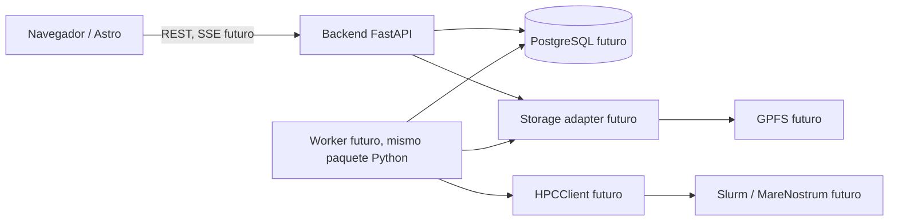

# Contrato de arquitectura — versión objetivo incremental

**Estado:** objetivo de diseño; solo el subconjunto descrito en `0001` queda dentro del primer incremento.

## Diagrama

**M0 solo crea el navegador, FastAPI y su health route**. Los nodos etiquetados «futuro» son compromisos de separación, no servicios que deban existir hoy.

## Límites normativos

- `frontend/src/features/<feature>/`: componente UI, interacciones y estado de su capacidad. Reutilizables sin dominio en `frontend/src/shared/`.
- `frontend/src/shared/api/client.ts`: frontera HTTP configurada. El navegador no conoce credenciales ni rutas del cluster.
- `backend/app/features/<feature>/`: router, dominio, persistencia y ejecución de esa feature **cuando haga falta**. No generar una capa transversal gigante de `routers/`, `services/`, `repositories/`.
- `backend/app/core/`: configuración y preocupaciones generales reales.
- `backend/app/infrastructure/`: implementaciones técnicas reemplazables (HPC, storage) solo cuando las use una feature.
- `backend/app/main.py`: composition root de FastAPI; sin lógica científica.
- `backend/app/worker.py` (futuro): entrypoint de procesamiento que reutiliza el mismo código. Su incorporación exige spec específica y estados persistidos.

## Contrato público inicial

`GET /api/v1/health` responde con HTTP 200 y JSON `{"status":"ok"}` mientras el proceso atienda peticiones. **No implica disponibilidad de PostgreSQL, HPC ni pipeline científico.** El cliente web debe indicar estado indisponible cuando la petición falle o el payload no cumpla contrato.

## Invariantes científicos reservados para integración futura

- Residuo canónico: `(protein_id, aa_position, aa_ref)`; `aa_position` 1-based.
- Los merges per-residue deben validar como mínimo `aa_position` + `aa_ref`.
- `NA` no equivale a `0`.
- La evidencia transmembrana biológica no depende de un pLDDT alto.
- AF3 confidence no demuestra estabilidad, función ni patogenicidad.
- Ningún output científico pesado debe copiarse por cada run sin necesidad: definir identificación, referencias, hashes y provenance antes de la implementación.

## Fuentes técnicas existentes y su interpretación

Hay documentos de un pipeline ya desarrollado (18 stages, `annotations.tsv`, caché y runs) y un documento separado de **arquitectura propuesta** para convertirlo en servicio. No declarar equivalencia plena entre ambos: por ejemplo, la propuesta más antigua representa un nodo `reference_preparation`, mientras que la documentación vigente del pipeline usa `protein_relaxation_energy`. Antes de una migración científica, comparar los contratos contra el código y registrar incompatibilidades. Este scaffold no debe cambiar el pipeline de MareNostrum 5.

## Conectividad y acceso para inspección de desarrollo

- `HPCClient` administra la **ejecución** (mock/ssh por VPN + password/native autorizado). No colocarlo en el frontend.
- `ReadOnlyMN5Inspector` es **herramienta interna de inspección**, no endpoint de producto: listado/stat/preview por SFTP read-only en desarrollo o GPFS local en host BSC aprobado. No expone `exec`, escrituras o mutación del filesystem.
- Solo raíz `/gpfs/projects/bsc08/bsc001997/vcfs_1000geno/hilo_integrado_anotacion`, incluidos descendientes. No presentar otras rutas ni credenciales al cliente; validación de paths por componentes y prohibición de symlinks.
- La VPN se levanta en el host Linux/Windows, fuera de FastAPI; el modo mock funciona offline. Producción en BSC requiere aprobación de servicio permanente, no solo cuenta y espacio GPFS.
- Contrato: [`mn5-readonly-inspection.md`](mn5-readonly-inspection.md).
