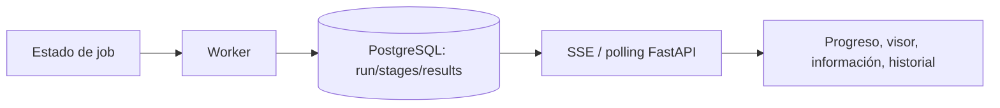

# 03 — Seguimiento y resultados

**Estado:** implementación local de SEG-001 a SEG-012 completada y verificada con los gates disponibles en este checkout. SEG-013 y SEG-014 siguen siendo posteriores. El transporte VPN/SFTP y la inspección read-only de la raíz autorizada de MN5 fueron verificados el 2026-10-15 mediante el perfil Compose, sin `sudo` en el host. La ejecución científica remota no se lanza desde esta validación porque la frontera aprobada para MN5 es estrictamente de solo lectura.

## Objetivo

Dar a la persona usuaria una vista honesta y progresiva desde la confirmación de la run hasta la consulta de sus resultados científicos, sin exigirle conocer Slurm, VPN, SSH ni el worker.

La interfaz debe mostrar el estado persistido y los artefactos realmente publicados. Nunca debe transformar un stage pendiente, una confianza estructural, un valor `NA` o una vista de demostración en evidencia científica.

## Experiencia del usuario

1. Después de confirmar, la persona ve una pantalla de preparación.
2. El sistema explica si está validando la proteína, preparando datos, enviando el análisis o esperando recursos.
3. Cuando el job está realmente en ejecución, se habilitan las vistas de seguimiento.
4. La persona ve el DAG y los estados de sus stages, incluidos reusos, omisiones y fallos.
5. Puede abrir el visor molecular aunque falten resultados, pero cada modo indica claramente si está pendiente o disponible.
6. Las anotaciones y artefactos aparecen conforme se publican, sin recargar manualmente toda la aplicación.
7. Al finalizar, la persona puede volver a la run y distinguirla de otras ejecuciones de la misma proteína.

## Comportamiento esperado

### Preparación y estados visibles

La interfaz diferencia preparación, espera de recursos y ejecución real:

- “Validando tu proteína”.
- “Preparando el análisis”.
- “Preparando los datos científicos”.
- “Enviando el análisis”.
- “Esperando recursos de cómputo”.
- “Tu análisis está en ejecución”.

Los textos son producto; se mapean a los estados persistidos sin inventar estados incompatibles. No se muestra porcentaje temporal ni se dice `running` mientras Slurm sólo mantiene el job pendiente. Si el job falla antes de comenzar, la pantalla muestra el error y permite consultar la run.

Las vistas de ejecución se habilitan cuando la run o el job tienen evidencia de ejecución real según el contrato del worker. La existencia de una run creada o un stage `ready` no basta.

### Progreso y DAG

La vista representa el DAG que el backend creó para esa configuración:

- stages pendientes, listos, en cola, en ejecución, reutilizados, completados, fallidos, omitidos y cancelados;
- dependencias y descendientes afectados;
- razón de omisión o bloqueo;
- job/lease sólo cuando sea útil y seguro para soporte;
- progreso global derivado de estados reales, sin ocultar stages por una política de demo.

`reused` se presenta como “resultado reutilizado” y conserva el vínculo al resultado; no se presenta como si el cálculo se hubiera ejecutado durante la run actual. Dos runs idénticas siguen apareciendo como dos elementos del historial.

### Actualizaciones incrementales

- El navegador consulta FastAPI.
- FastAPI entrega snapshots persistidos y eventos SSE cuando estén disponibles.
- Si SSE se desconecta, el frontend vuelve a consultar el snapshot/polling y reconcilia sin perder estados.
- La llegada de un nuevo artefacto o anotación actualiza la vista, el visor y la información sin recarga completa.
- El frontend no se conecta directamente al worker, Slurm, GPFS o SSH.

### Visor molecular

Se conservan exactamente los cuatro modos existentes identificados en el producto:

| Modo | Dato que lo habilita | Regla de disponibilidad |
| --- | --- | --- |
| Régimen estructural | `structural_regime` | Requiere estructura válida, mapping y anotación de régimen publicada. |
| Frustración estructural | `structural_frustration_fi_singleresidue` | Requiere el resultado de frustración estructural correspondiente. |
| Contactos | `structural_contacts_n_contacts` | Requiere resumen de contactos y mapping estructural válido. |
| Conservación | `rate4site_score` | Requiere evidencia de conservación publicada y mapeada. |

La lista no se amplía durante esta entrega. Si el resultado todavía no existe, el control muestra espera o disponibilidad parcial, pero no habilita un coloreado vacío. La estructura puede mostrarse cuando el artefacto estructural está disponible aunque otros modos sigan pendientes.

La selección de residuos conserva identidad estructural y canónica sólo cuando el mapping está validado. `aa_position` es 1-based y `aa_ref` se comprueba durante las uniones. `NA` es ausencia de información; nunca se convierte en cero. La confianza de AF3 no se presenta como estabilidad, función ni patogenicidad.

### Información y artefactos

La vista de información distingue `pending`, `partial`, `available`, `skipped` y `failed` según los datos reales. Sólo muestra filas y valores publicados, sus unidades, QC, fuente y provenance. Un botón de descarga o exportación se muestra como funcional únicamente si FastAPI ofrece el archivo correspondiente; de lo contrario se deshabilita o se presenta como pendiente.

### Historial

La persona puede consultar todas sus runs autorizadas, no sólo la activa. Cada entrada conserva:

- proteína y fecha;
- configuración confirmada, incluyendo variantes y fuente estructural;
- estado global;
- stages y sus estados;
- resultados, reusos y errores relevantes;
- enlaces a artefactos permitidos.

Una nueva ejecución idéntica no sobrescribe ni mezcla la anterior. El historial permite distinguir `run_id` y recuperar cada resultado de forma independiente.

## Contratos esenciales

### Fuente única de estado

- PostgreSQL conserva snapshots durables de run, stages, resultados y errores.
- SSE/polling es transporte, no una segunda fuente de verdad.
- El visor consume artefactos y anotaciones autorizados por la API.
- Los cuatro modos se habilitan por presencia y validez del dato que cada uno necesita, no por la posición del stage en una lista ni por tiempo transcurrido.
- Un `RunStage` `reused` puede apuntar a un `StageResult` de otra run, pero la UI conserva la identidad de la run actual y su timestamp.

### Contrato de resultados por residuo

- `aa_position` es canónica y 1-based.
- Los merges verifican `aa_position` y `aa_ref`.
- La ausencia de dato se conserva como `NA`/estado ausente.
- Cada resultado expone QC, fuente, unidades y provenance cuando estén disponibles.
- La vista estructural no afirma mapping canónico si el stage no lo publicó validado.

### Evidencia técnica usada

- Los cuatro campos que alimentan los modos están definidos en [`frontend/src/features/annotations/viewer-presentation.js`](../frontend/src/features/annotations/viewer-presentation.js) y el visor usa Mol* en [`frontend/src/features/annotations/components/viewer/ProteinViewer.jsx`](../frontend/src/features/annotations/components/viewer/ProteinViewer.jsx).
- La API tiene snapshots de run, stages, anotaciones parciales, SSE y un listado autorizado de historial: [`backend/app/features/runs/router.py`](../backend/app/features/runs/router.py) y [`backend/app/features/runs/schemas.py`](../backend/app/features/runs/schemas.py).
- El inventario del estado actual y sus límites científicos se conserva en [`AUDIT_REPORT.md`](../AUDIT_REPORT.md).

## Estado actual

### Implementado y verificado localmente

- El frontend consulta la API real, tiene flujo de onboarding, progreso, información y visor Mol*.
- Existen estados persistidos y transiciones `pending`, `ready`, `queued`, `running`, `reused`, `success`, `failed`, `skipped` y `cancelled`; el backend sólo promueve a `running` cuando el worker local inicia ejecución o el polling remoto observa el job ejecutándose.
- `stage-visibility.js` representa todos los stages persistidos y no aplica una lista de stages ocultos de demo.
- La API ofrece lectura de una run, listado autorizado de historial, stages, anotaciones parciales, artefactos y eventos SSE con fallback de snapshot/polling.
- El progreso distingue preparación, validación, envío, espera de recursos, ejecución real, fallos y cancelación; conserva DAG, omisiones, descendientes y reusos.
- El visor conserva exactamente cuatro modos y los habilita según estructura, mapping válido y campo publicado; actualiza la fuente de la run mediante SSE/polling y mantiene fallback textual cuando Mol* no está disponible.
- La información distingue estados de evidencia, muestra sólo valores publicados con unidades/QC/provenance y habilita descargas únicamente para artefactos existentes.
- El historial lista runs autorizadas y permite abrir cada `run_id` de forma independiente, incluso para dos ejecuciones de la misma proteína.

### Gate externo de transporte e inspección read-only

El gate de conectividad e inspección quedó **VERIFIED / READ-ONLY** el 2026-10-15:

- El perfil Compose `vpn` levantó el túnel y creó `ppp0` dentro de su namespace de red; no se necesitó `sudo` en el host.
- `glogin4.bsc.es` resolvió a través de los DNS entregados por la VPN (`84.88.52.35`/`84.88.52.36`) y la host key configurada fue aceptada por Paramiko con `RejectPolicy`.
- El `SFTPReadOnlyInspector` del backend abrió una sesión SFTP real con la cuenta configurada, validó la raíz exacta `/gpfs/projects/bsc08/bsc001997/vcfs_1000geno/hilo_integrado_anotacion` y listó 56 entradas.
- Se revisaron por SFTP únicamente metadatos y documentación autorizados. El manifiesto `benchmarks/multinode_baseline_47265106/` permitió leer `meta.json`, `dag_contracts.json`, `stages.tsv`, `summary.tsv` y `code_sha256.tsv` con límites de tamaño y hashes registrados; no se descargaron archivos de datos ni archivos comprimidos.
- No se abrió shell remoto, no se ejecutó `sbatch`, `squeue`, `sacct` ni `scancel`, y no se realizó ninguna operación SFTP de escritura.

El perfil Compose declara esos DNS mediante `HPC_VPN_DNS_PRIMARY` y `HPC_VPN_DNS_SECONDARY`. Docker conserva su resolver interno, pero lo configura para reenviar a los DNS BSC; así el `healthcheck` del contenedor `vpn`, el `worker-vpn` y el inspector usan el mismo endpoint sin que `openfortivpn` tenga que modificar `/etc/resolv.conf`. La verificación posterior dejó `vpn=healthy`, `worker-vpn=running` y repitió el inspector sin ningún parche de resolución.

### Gate de ejecución científica

Este gate queda **NOT RUN** por la frontera de seguridad de esta tarea. No se puede afirmar una corrida científica end-to-end, polling de Slurm ni publicación de resultados en MN5 a partir de la inspección read-only. Los tests locales, fixtures y mocks validan el contrato de seguimiento, pero no sustituyen una ejecución autorizada.

## Requisitos funcionales

### Imprescindible

- **SEG-001 — Preparación honesta.** Tras confirmar una run, MUST mostrar preparación y espera de recursos separadas de ejecución; no puede afirmar `running` antes de la señal real del job/worker.
- **SEG-002 — Error visible.** Un fallo previo al inicio, un stage fallido, una omisión y una cancelación MUST ser visibles con estado y mensaje accionable; la persona no puede quedar atrapada en una pantalla de preparación indefinida.
- **SEG-003 — DAG real.** La vista MUST representar los stages y dependencias persistidos para esa run, sin ocultarlos por `DEMO_DISABLED_STAGE_IDS` u otra política de demostración en el comportamiento normal.
- **SEG-004 — Reuso explícito.** La vista MUST mostrar `reused` como resultado reutilizado y distinguirlo de `success` calculado durante la run. El `stage_result_id` y provenance deben seguir siendo consultables según autorización.
- **SEG-005 — SSE/polling resiliente.** El frontend MUST actualizarse con snapshots/SSE y MUST resincronizarse por polling o lectura completa después de una desconexión.
- **SEG-006 — Visor progresivo.** El visor MUST mantener los cuatro modos existentes y habilitar cada uno sólo cuando su resultado/mapping esté disponible. La llegada de un artefacto posterior MUST reflejarse sin recarga completa.
- **SEG-007 — Evidencia correcta.** Las vistas MUST conservar `NA`, cero válido, QC, unidades, fuente y mapping, sin interpretar confianza AF3 como estabilidad, función o patogenicidad.
- **SEG-008 — Historial.** La persona MUST poder listar y abrir sus runs anteriores, incluyendo dos runs de la misma proteína, sin que una nueva run sobrescriba otra.

### Necesario para cerrar la entrega

- **SEG-009 — Estados de información.** La vista de información MUST distinguir pendiente, parcial, disponible, omitida y fallida por stage, y MUST actualizar anotaciones publicadas de forma incremental.
- **SEG-010 — Descargas honestas.** Los controles de descarga/exportación MUST estar habilitados sólo cuando la API proporcione el artefacto y la autorización correspondiente.
- **SEG-011 — Acceso independiente.** Abrir una run desde el historial MUST recuperar su propia configuración, stages, resultados y errores, aunque comparta `StageResult` con otra run.
- **SEG-012 — Accesibilidad de fallo visual.** Si WebGL/Mol* no está disponible, MUST existir una representación textual de estados y datos sin fingir una visualización 3D.

### Posterior, sin bloquear la primera consulta progresiva

- **SEG-013 — Comparación de runs.** El historial podrá comparar configuraciones y resultados sin fusionar sus estados.
- **SEG-014 — Filtros de historial.** Se podrán añadir filtros por proteína, fecha o estado después de disponer del listado básico autorizado.

## Casos límite

- La run existe pero aún no tiene stage `RUNNING`: se mantiene la pantalla de preparación/espera y no se habilitan vistas que impliquen ejecución.
- Slurm está pendiente por recursos: se muestra “esperando recursos”, no porcentaje ni “en ejecución”.
- El job falla antes del primer resultado: se muestra el error y el detalle de la run sigue accesible.
- La estructura llega antes que conservación/frustración/contactos: se permite la vista estructural disponible y se mantienen los otros modos pendientes.
- Un artefacto llega después de abrir el visor: se actualiza el modo afectado y no se borra una selección de residuo válida.
- Hay estructura pero el mapping no valida: se muestra estructura e identidad estructural; no se inventa `aa_position` canónica.
- La tabla informa cero o `NA`: cero se conserva como cero y `NA` como ausencia.
- Un stage está `reused`: se muestra que el resultado proviene de caché, pero la run y sus timestamps siguen siendo los propios.
- SSE se corta durante una transición: el polling recupera el snapshot persistido sin duplicar filas ni retroceder un estado terminal.
- Un artefacto no está disponible o no hay permiso: se muestra pendiente/no autorizado; no se expone una ruta GPFS ni se habilita una descarga rota.
- Dos runs idénticas aparecen en historial: tienen filas, enlaces y estados separados, aunque algunas anotaciones apunten al mismo `StageResult`.

## Criterios de aceptación

- Después de confirmar, la persona puede entender si la run está preparando, esperando recursos, ejecutándose, terminada, fallida, omitida, cancelada o reutilizando resultados.
- El progreso muestra el DAG y todos los estados reales de la configuración, sin stages ocultos por una política de demo.
- SSE y fallback de polling mantienen la vista consistente tras desconexiones y reinicios del frontend.
- Cada uno de los cuatro modos del visor se habilita sólo con su anotación/artefacto válido: régimen, frustración estructural, contactos y conservación.
- La disponibilidad parcial se actualiza cuando llega un resultado, sin recargar manualmente la página; los datos ausentes no se convierten en cero.
- La vista de información sólo muestra valores, QC, unidades y provenance publicados, y los botones de descarga no prometen archivos inexistentes.
- El usuario puede listar y abrir dos runs distintas de la misma proteína y ver su configuración, stages, resultados y errores respectivos.
- Una prueba autorizada con resultados científicos publicados demuestra el recorrido progresivo; una fixture o un mock se etiqueta como tal y no se presenta como aceptación MN5.

## Trabajo pendiente

1. `[x]` Sustituir la política de stages deshabilitados de demo por visibilidad derivada de configuración, dependencias y resultados.
2. `[x]` Modelar y mostrar estados de preparación/espera con señales reales de worker y Slurm.
3. `[x]` Corregir el progreso para que use el DAG y los estados persistidos, incluyendo `reused`, omisiones y descendientes bloqueados.
4. `[x]` Implementar refresco de artefactos/anotaciones en visor e información mediante SSE/polling sin perder selección ni duplicar filas.
5. `[x]` Habilitar cada uno de los cuatro modos sólo cuando su dato/mapping esté disponible y conservar los mensajes de ausencia/QC.
6. `[x]` Añadir endpoint y UI de historial autorizado con configuración resumida, estados, resultados y errores.
7. `[x]` Conectar descargas sólo a artifacts publicados y autorizados; retirar placeholders que parezcan funcionales.
8. `[ ]` Probar el flujo con una ejecución MN5 autorizada y documentar el primer resultado real antes de ampliar la cobertura; **NOT RUN** en esta validación porque la frontera de MN5 disponible es estrictamente read-only.

## Fuera de alcance

- Añadir modos de visor nuevos o sustituir los cuatro existentes.
- Conectar el navegador directamente con Slurm, SSH, VPN o GPFS.
- Crear un explorador de archivos remoto.
- Reemplazar SSE/polling por WebSockets sin una necesidad demostrada.
- Inventar porcentajes, anotaciones, resultados científicos o equivalencias a partir de mocks.
- Cambiar algoritmos científicos, reglas de mapping, definición de `NA` o la interpretación de AF3.
